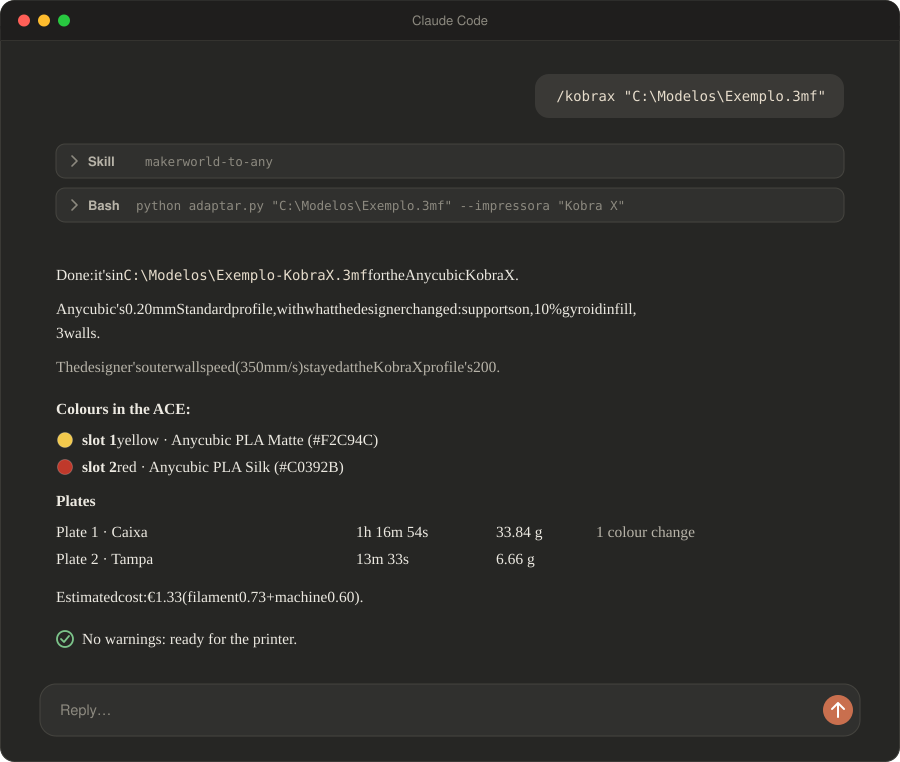
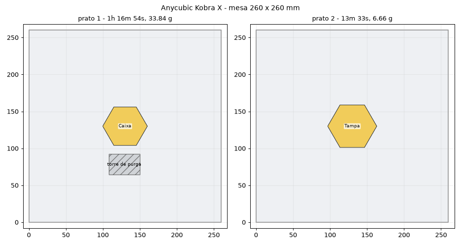

<p align="center">
  
</p>

<h1 align="center">MakerWorld to Any</h1>

<p align="center">
  <b>MakerWorld projects ready to print on your Anycubic, with one command.</b><br>
  <sub>A Claude Code skill · made by <a href="https://megatic.pt"><b>Megatic</b></a> · <a href="README.md">🇵🇹 Português</a></sub>
</p>

<p align="center">
  <a href="https://github.com/GodFaizT/makerworld-to-any/releases/latest"></a>
  <a href="https://github.com/GodFaizT/makerworld-to-any/actions/workflows/verificacao.yml"></a>
  
  
  
  <a href="LICENSE"></a>
</p>

Models on [MakerWorld](https://makerworld.com) are made in Bambu Studio for Bambu Lab printers. Opened in **Anycubic
Slicer Next** they lose their profiles, keep Bambu filaments with the wrong temperatures, switch the prime tower off
and sometimes crash the program. **MakerWorld to Any** deals with all of that through Anycubic's own command line and
checks the result by slicing it: you give it a `.3mf` and get a project that is ready to print, with the time and
grams of every plate.

<p align="center">
  
  <br><sub>What it looks like in Claude. The numbers come from a real adaptation of the example project that ships with the skill (2 plates, 2 colours).</sub>
</p>

> **A note on language.** The skill was written in Portugal: commands, script options and reports are in Portuguese.
> You don't need to speak it — ask Claude in English and it answers in English. This page translates everything you
> need to type.

## 🚀 Get started in a minute

> **You need:** [Claude Code](https://claude.com/claude-code) · [Anycubic Slicer Next](https://www.anycubic.com) (Windows) · [Python 3](https://www.python.org/downloads/)

**1. Install** — inside Claude Code:

```text
/plugin marketplace add GodFaizT/makerworld-to-any
/plugin install makerworld-to-any@makerworld-to-any
```

**2. Open a new** Claude Code session.

**3. Adapt** — your printer's command and the path to the file:

```text
/kobrax "C:\Downloads\Vase.3mf"
```

That's it: `Vase - Kobra X.3mf` appears next to the original, already checked, with time and grams for every plate.

To confirm everything is in place: `/any-diagnostico teste` adapts and slices an example project in under a minute.

<details>
<summary><b>Other ways to install</b> (npx, ZIP, Claude app)</summary>

<br>

| How | Command / steps |
|---|---|
| **npx** (no plugin) | `npx github:GodFaizT/makerworld-to-any` — installs to `~/.claude/skills` (`--projeto` for the current project only, `--desinstalar` to remove) |
| **npx skills** | `npx skills add GodFaizT/makerworld-to-any` |
| **ZIP** | Download `makerworld-to-any-v….zip` from the [releases](https://github.com/GodFaizT/makerworld-to-any/releases/latest), unzip it and double-click `instalar.bat` |
| **Claude app (_Code_ tab)** | That is Claude Code inside the app: install the plugin as above. Everything works. |
| **claude.ai chat** | Upload `makerworld-to-any-skill.zip` under **Settings → Capabilities → Skills**. The chat runs on a server without Anycubic Slicer Next, so Claude can explain and advise but cannot adapt or slice. |

`numpy` is optional (`pip install numpy`): with it the skill measures the real gap between parts and can push them
apart.

</details>

## ⚡ Commands

Type the command, the path to the `.3mf` (or to a **folder**, to adapt every file in it) and, if you like, anything
else you want in plain words.

| Command | What it does |
|---|---|
| `/kobrax <file>` | adapt for the Anycubic **Kobra X** |
| `/kobra4` · `/kobras1` · `/kobras1max` · `/kobra3` · `/kobra3max` | the same for the **Kobra 4**, **S1**, **S1 Max**, **Kobra 3** and **3 Max** |
| `/anycubic <printer> <file>` | any other: Kobra 2 Neo, Kobra 3 V2, Kobra 1… |
| `/any-pratos <adapted file>` | arrange **plates**: move objects, one per plate, merge, push parts apart |
| `/any-cores <adapted file>` | **colours** per part, add a colour, change colours or the material |
| `/any-desfazer [file]` | **undo**: restore the previous version of a file |
| `/any-perfil` | **preferences**: your profiles, your printer, folders and prices |
| `/any-diagnostico [teste]` | **diagnostics**: check that everything works (`teste` = full self-test) |
| `/any-update` | update the skill and its commands |

```text
/kobrax "C:\Downloads\Vase.3mf"
/kobras1 "C:\Downloads\Vase.3mf" 12 cm tall, in gold PLA Silk
/kobrax "C:\Downloads\Vase.3mf" with my own profiles
/kobrax "C:\Downloads\Vase.3mf" in PETG and keep the g-code
/kobra3max "C:\Downloads\MakerWorld"                  ← every .3mf in the folder
/anycubic Kobra 2 Neo "C:\Downloads\Vase.3mf" 0.6 nozzle
```

You can also just ask: *"convert this file for my Kobra X"*, *"make the vase 10 cm tall"*, *"put the body on one plate
and the lid on another"*, *"the name in blue and the rest in white"*, *"how long does this take?"*.

## 🧰 After adapting: plates, colours, size

An adapted project can be reworked without going back to the original. Every change is sliced again, so you know the
time and grams, and a copy of the previous file is always kept.

<p align="center">
  
  <br><sub>What the skill sees: the real outline of each part (not its bounding box), the prime tower, and the time and grams of each plate.</sub>
</p>

**Plates** — `/any-pratos`

```text
/any-pratos "C:\…\Vase - Kobra X.3mf"                                 ← what is on each plate
/any-pratos "C:\…\Vase - Kobra X.3mf" the body on one plate and the lid on another
/any-pratos "C:\…\Vase - Kobra X.3mf" one object per plate
/any-pratos "C:\…\Vase - Kobra X.3mf" put everything on one plate, 6 mm apart
```

The skill measures the **real gap** between parts from their shape. It warns when two parts are less than 2 mm apart
(they may fuse on the first layer) and can push them apart. The prime tower always goes somewhere that is actually
free.

**Colours per part** — `/any-cores`

```text
/any-cores "C:\…\Sign - Kobra X.3mf"                                  ← filament of every object and part
/any-cores "C:\…\Sign - Kobra X.3mf" the name in navy and the rest in white
/any-cores "C:\…\Sign - Kobra X.3mf" filament 2 in burgundy
/any-cores "C:\…\Sign - Kobra X.3mf" in PETG
```

You can move a part to another filament, add a colour the project didn't have, or just change the colours. The **purge
volumes are recalculated** for the new colours (navy to white needs three times the purge of white to navy): Anycubic's
command line does not do this and would keep the volumes of the old colours.

**Size** — ask in the command or afterwards: *"10 cm tall"*, *"same height as the other one"*, *"half size"*. Each
object grows around its own centre and stays on the bed.

**Undo** — `/any-desfazer`

```text
/any-desfazer                                 ← list the saved copies
/any-desfazer "C:\…\Vase - Kobra X.3mf"       ← restore the previous version
```

Before replacing a file the skill saves it (the last 30 copies, in `%APPDATA%\makerworld-to-any\copias`). Your
originals are never modified.

## 🖨 Printers

| Printer | Bed (mm) | Nozzles | Colours |
|---|---|---|---|
| **Kobra X** | 260 × 260 × 260 | 0.25 · 0.4 · 0.6 · 0.8 | 🌈 ACE |
| **Kobra 4** | 260 × 260 × 260 | 0.25 · 0.4 · 0.6 · 0.8 | 🌈 ACE |
| **Kobra S1** | 250 × 250 × 250 | 0.25 · 0.4 · 0.6 · 0.8 | 🌈 ACE |
| **Kobra S1 Max** | 350 × 350 × 350 | 0.25 · 0.4 · 0.6 · 0.8 | 🌈 ACE |
| **Kobra 3** · 3 V2 | 255 × 255 × 260 | 0.2 · 0.4 · 0.6 · 0.8 | 🌈 ACE |
| **Kobra 3 Max** · 3 Max V2 | 426 × 420 × 501 | 0.4 · 0.6 · 0.8 | 🌈 ACE |
| Kobra 2 · 2 Neo · 2 Pro | 220 × 220 × 250 | 0.4 | single colour |
| Kobra 2 Plus · 2 Max | 320³ · 426³ | 0.4 | single colour |
| Kobra 1 · 1 Plus · 1 Max | 220 · 300 · 400 | 0.4 | single colour |

The list comes from the Anycubic Slicer Next you have installed. Without an ACE, a multi-colour model becomes a
single-filament project and the skill tells you the colour the designer gave each object, so you can swap the spool
between plates.

## 🎛 Profiles: Anycubic's or your own

Every adaptation uses **three profiles** from Anycubic Slicer Next: the **printer** (bed, nozzle, start and end
g-code, filament changes), the **print** profile (layer height, walls, infill, speeds, supports, seam) and one
**filament** profile per colour (temperatures, cooling, retraction, flow).

- **Anycubic's profiles** (the default) — the official ones, tuned by Anycubic for each printer, nozzle and filament.
- **Your profiles** — the ones you tuned and saved in Anycubic Slicer Next. The skill uses yours whenever you have one
  based on the profile it picked, and Anycubic's otherwise.

```text
/any-perfil                                      ← what is selected, and the profiles you have
/any-perfil meus                                 ← always use my profiles from now on ("meus" = mine)
/any-perfil anycubic                             ← back to Anycubic's
/kobrax "C:\…\Vase.3mf" with my own profiles     ← just this once
/kobrax "C:\…\Vase.3mf" with 0.16 high quality   ← another print profile
```

**Who decides what**

| Settings | Where they come from |
|---|---|
| Speeds, accelerations, temperatures, retraction, cooling | the chosen profile (Anycubic's or yours) — never Bambu's |
| Supports, infill, walls, ironing, fuzzy skin, vase mode | the **model's designer**, because the model was designed that way |
| What you changed in your own profile (seam, arachne…) | **you**: it wins over values the designer only had by default |
| Layer height | the designer's; if you pick the profile yourself ("with 0.12"), that profile's |
| Speeds the designer changed | only pass when they are **lower** than your printer's profile |
| The designer's variable layer heights | kept (the report tells you the real average height); *"without variable layers"* ignores them |

The report separates what the designer **changed on purpose**, what came from **their base profile**, and what **was
not carried over** and why (it belongs to their printer, it doesn't exist in Anycubic's slicer, or it is a speed above
your profile). Your profiles are only ever read: the skill never writes to Anycubic's folder.

## 🧵 Filaments: each material gets its own profile

The skill looks at the material of each of the designer's filaments and picks the profile **for that material** on
your printer. The designer's colours are kept.

| Designer's material (Bambu) | Becomes (if your printer has it) | Notes |
|---|---|---|
| PLA Basic, Generic PLA | Anycubic PLA | |
| PLA Matte · Silk · Wood · Glow · Translucent · Marble · Galaxy/Sparkle · Metal | the matching Anycubic variant | plain PLA if the printer lacks it |
| PLA Tough / PLA+ | Anycubic PLA+ | |
| PLA-CF · PETG-CF · PET-CF | Anycubic PLA-CF · PETG-CF · PET-CF | 🔩 hardened nozzle |
| PETG (Basic, HF, Translucent) · PCTG | Anycubic PETG | PCTG: ⚠️ warns |
| ABS · ASA · PC · PC-CF · PC-GF | the Anycubic equivalent | 📦 enclosed printer |
| PA · PA6-CF · PAHT-CF | Anycubic PA · PA6-CF · PAHT-CF | 📦 enclosed · 🔩 hardened nozzle |
| TPU 95A · TPU for AMS | Anycubic TPU 95A · TPU for ACE | 🌀 external spool, or through the ACE with *TPU for ACE* |
| PVA | Anycubic PVA | 💧 keep it dry |
| Support for PLA | Anycubic PLA | ⚠️ warns (it was a support-only material) |

**If your printer has no profile for the material** (PC on the Kobra X, ASA on the Kobra 1…) the skill uses the
closest one and **always warns you**. It never swaps materials silently.

```text
/kobrax "C:\…\Vase.3mf" in PETG
/kobras1max "C:\…\Bracket.3mf" in PA6-CF
```

## 📁 Folders and the cost of each job

`/any-perfil` also stores where you want your files and what printing costs you:

```text
/any-perfil save adapted files in D:\Prints\Adapted and originals in D:\Prints\Originals
/any-perfil PLA is 18 euros a kilo, PETG 20, the machine 40 cents an hour
```

- **Adapted folder** — everything you adapt goes there (put `{impressora}` in the path for one folder per printer).
- **Originals folder** — an original dropped in the folder above it is tidied away there once adapted.
- **Prices** — per kilo of each material and per machine hour. The report then includes the **estimated cost** of each
  job (filament + hours), as in the image at the top. Failed prints, electricity or your own time only count if you
  put them in the hourly price.

## ✨ What it does for you

| | |
|---|---|
| 🎯 **The right profile** | Your printer's profile with the same name as the designer's (`0.20mm Standard @BBL A1` → `0.20mm Standard @Anycubic Kobra X`) |
| 🎨 **Filaments and colours** | Works out which filaments the model *really* uses and picks each material's profile for your printer, keeping the colours |
| 🗼 **Prime tower and purge** | Turns the prime tower on when there are colours, places it somewhere free on every plate, recalculates purge volumes when colours change |
| 🧩 **Nothing lost** | Plates, parts, modifiers, colour painting, fuzzy skin, variable layer heights and the designer's credits |
| 🩹 **Anycubic's bugs** | Works around the known crashes and mistakes of Anycubic's command line |
| 📐 **Real gaps** | Measures the distance between parts from their shape and warns about parts that may fuse |
| ✅ **Verified** | Same dimensions as the original, everything inside the bed, and every plate sliced |
| ↩️ **Nothing to fear** | Keeps a copy before replacing a file; `/any-desfazer` restores it |
| 💶 **Cost** | With your prices, the estimated cost of each job |
| 🧷 **End of print** | Where the stock end g-code leaves the nozzle resting on the part (Kobra X, 4, S1 Max) it lifts it 5 mm |

## 🔄 Updating and diagnostics

```text
/any-update              ← latest version from GitHub (skill and commands)
/any-diagnostico         ← Python, Anycubic Slicer Next, profiles and preferences
/any-diagnostico teste   ← adapts, changes colours, rearranges plates and slices an example project
```

After updating **Anycubic Slicer Next**, run `/any-diagnostico teste`: the skill was tested with version 2.0.0.3 and
the self-test tells you whether everything still works with yours. What changed in each version is in the
[CHANGELOG](CHANGELOG.md) (in Portuguese).

## ❓ FAQ

<details>
<summary><b>Does it work in the claude.ai chat or only in Claude Code?</b></summary>

<br>It has to run Anycubic Slicer Next on your computer, so it adapts in **Claude Code** (terminal, VS Code, or the
*Code* tab of the Claude app for Windows). In the claude.ai chat the skill can only explain and advise.
</details>

<details>
<summary><b>Does it touch my profiles or my files?</b></summary>

<br>Your profiles are only read. Originals are never modified (they only change folder if you set an originals
folder). When an adapted file is replaced a copy is kept, and `/any-desfazer` brings it back.
</details>

<details>
<summary><b>Can I print the saved g-code directly?</b></summary>

<br>With *"keep the g-code"* you get each plate's g-code exactly as Anycubic Slicer Next sliced it. The recommended
route is still to open the `.3mf` in Anycubic Slicer Next and send it from there: you see the preview and the ACE
slots get mapped. Printing the g-code directly is for people who know what they are doing.
</details>

<details>
<summary><b>What about the models' credits and licences?</b></summary>

<br>The skill keeps the original designer's credits in the project. The models still belong to their designers:
respect each licence (many are for personal use only).
</details>

<details>
<summary><b>Can I use it without Claude?</b></summary>

<br>Yes, the scripts are plain Python (`numpy` and `matplotlib` are optional). Option names are Portuguese:

```bash
cd skills/makerworld-to-any/scripts
python adaptar.py --listar-impressoras                           # list printers
python adaptar.py "Model.3mf"                                    # → Model - Kobra X.3mf
python adaptar.py "Model.3mf" --impressora "Kobra S1" --perfis meus --gcode gcode
python escalar.py "Model - Kobra X.3mf" --altura 120 --fatiar    # height 120 mm, slice; keeps a copy
python pratos.py "Model - Kobra X.3mf" --mover "body=1;lid=2" --fatiar
python pratos.py "Model - Kobra X.3mf" --afastar 6 --fatiar      # at least 6 mm between parts
python cores.py "Model - Kobra X.3mf" --atribuir "lid=2" --cores ";#232C7C"
python medir.py "Model - Kobra X.3mf" --fatiar --imagem plates.png
python desfazer.py "Model - Kobra X.3mf"                         # undo
python perfil.py meus --impressora "Kobra X" --preco-kg "PLA=18;*=22" --preco-hora 0.40
python diagnostico.py --teste                                    # self-test
python exemplo.py Example.3mf                                    # the example project used in the images above
```

| `adaptar.py` option | meaning |
|---|---|
| `--impressora "Kobra S1"` · `--bico 0.6` | target printer and nozzle |
| `--perfis sistema\|meus` | Anycubic's profiles or yours |
| `--processo "0.16mm High Quality"` | another print profile |
| `--material PETG` | change the material of every filament (colours stay) |
| `--filamentos "…;…"` · `--cores "#FFFFFF;#800020"` | filament profiles and colours, in order |
| `--atribuir "lid=2;1.3=2"` | filament of objects and parts |
| `--sem-camadas-variaveis` | ignore the designer's variable layer heights |
| `--gcode FOLDER` | also save each plate's g-code |
| `--saida FOLDER` · `--nome FILE` · `--substituir` | where to save · file name · overwrite (keeps a copy) |
| `--sem-fatiar` · `--json` | export only · JSON report |

</details>

<details>
<summary><b>I want to work on the code</b></summary>

<br>

```bash
python tools/verifica.py                        # version, generated commands, syntax, personal data
python tools/gera_comandos.py                   # every /kobrax, /any-… command is generated here
python tools/gera_docs.py                       # the images in this README, from a real run
python tools/publica.py 2.1.0                   # prepare a release: one version number, checks and ZIPs
```

Technical notes on Anycubic's command line are in
[`skills/makerworld-to-any/referencia/notas.md`](skills/makerworld-to-any/referencia/notas.md) (in Portuguese).
</details>

---

<p align="center">
  <br>
  <a href="https://megatic.pt"></a>
  <br><br>
  Made with ❤️ in Portugal by <a href="https://megatic.pt"><b>Megatic</b></a><br>
  <sub>An independent project, not affiliated with Bambu Lab, Anycubic or MakerWorld · MIT licence</sub>
</p>
