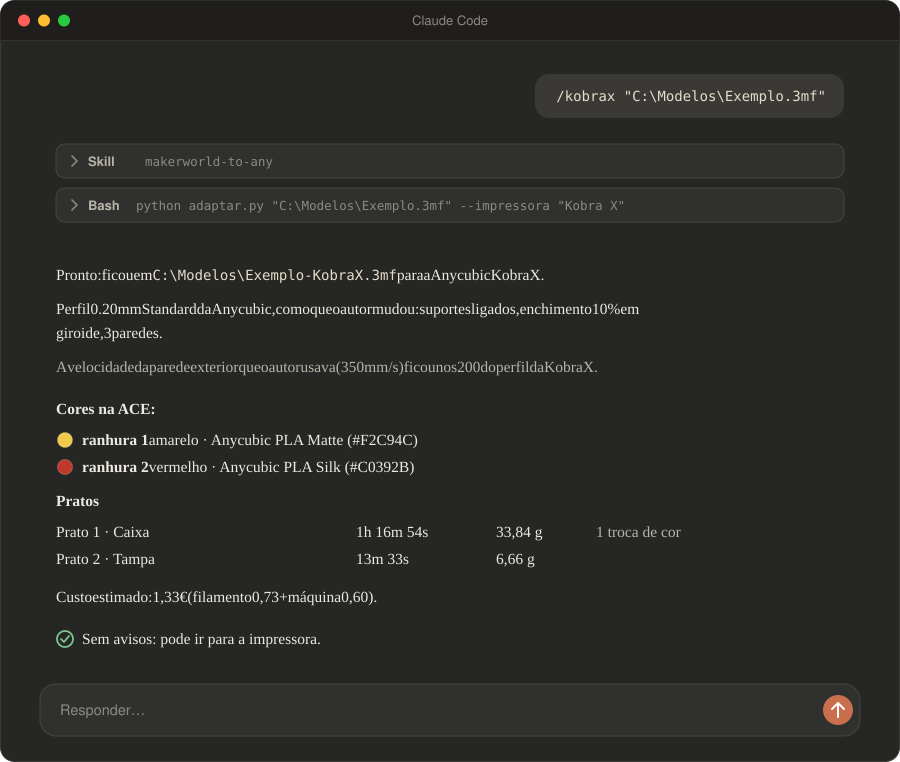
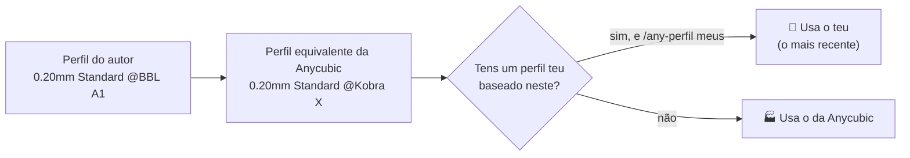
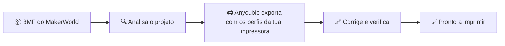

<p align="center">
  
</p>

<h1 align="center">MakerWorld to Any</h1>

<p align="center">
  <b>Projetos do MakerWorld prontos a imprimir na tua Anycubic, com um comando.</b><br>
  <sub>Skill do Claude Code · feita pela <a href="https://megatic.pt"><b>Megatic</b></a></sub>
</p>

<p align="center">
  <a href="https://github.com/GodFaizT/makerworld-to-any/releases/latest"></a>
  
  
  
  <a href="LICENSE"></a>
  <a href="https://megatic.pt"></a>
</p>

<p align="center">
  <a href="#comecar"><b>Começar</b></a> ·
  <a href="#comandos"><b>Comandos</b></a> ·
  <a href="#impressoras"><b>Impressoras</b></a> ·
  <a href="#perfis"><b>Perfis</b></a> ·
  <a href="#filamentos"><b>Filamentos</b></a> ·
  <a href="#atualizar"><b>Atualizar</b></a> ·
  <a href="#perguntas"><b>Perguntas</b></a>
</p>

<p align="center">
  
</p>

Os modelos do [MakerWorld](https://makerworld.com) são feitos no Bambu Studio para impressoras Bambu Lab. Abertos
no **Anycubic Slicer Next** perdem perfis, ficam com filamentos da Bambu com temperaturas erradas, desligam a torre
de purga e às vezes até rebentam o programa. A **MakerWorld to Any** trata disso tudo com a linha de comandos do
próprio Anycubic e confirma o resultado fatiando: dás-lhe um `.3mf` e recebes um projeto pronto a imprimir, com o
tempo e as gramas de cada prato.

<a id="comecar"></a>

## 🚀 Começar em 1 minuto

> **Precisas de:** [Claude Code](https://claude.com/claude-code) · [Anycubic Slicer Next](https://www.anycubic.com) (Windows) · [Python 3](https://www.python.org/downloads/)

**1. Instala** — dentro do Claude Code:

```text
/plugin marketplace add GodFaizT/makerworld-to-any
/plugin install makerworld-to-any@makerworld-to-any
```

**2. Abre uma sessão nova** do Claude Code.

**3. Adapta** — o comando da tua impressora e o caminho do ficheiro:

```text
/kobrax "C:\Downloads\Vaso.3mf"
```

Pronto: fica `Vaso - Kobra X.3mf` ao lado do original, já verificado, com tempo e gramas de cada prato. 🎉

<details>
<summary><b>Outras formas de instalar</b> (npx, ZIP, app do Claude)</summary>

<br>

| Como | Comando / passos |
|---|---|
| **npx** (sem plugin) | `npx github:GodFaizT/makerworld-to-any` — instala em `~/.claude/skills` (`--projeto` só no projeto atual, `--desinstalar` para remover) |
| **npx skills** | `npx skills add GodFaizT/makerworld-to-any` |
| **ZIP** | Descarrega `makerworld-to-any-v….zip` das [releases](https://github.com/GodFaizT/makerworld-to-any/releases/latest), descompacta e dá duplo clique em `instalar.bat` |
| **App Claude (separador _Code_)** | É o Claude Code dentro da app: instala o plugin como acima. Funciona tudo. |
| **Chat do claude.ai / da app** | Carrega `makerworld-to-any-skill.zip` em **Definições → Capacidades → Skills**. O chat corre num servidor sem o Anycubic Slicer Next: o Claude explica e aconselha, mas não adapta nem fatia. |

</details>

<a id="comandos"></a>

## ⚡ Comandos

Escreve o comando, o caminho do `.3mf` (ou de uma **pasta**, para adaptar todos os que lá estão) e, se quiseres,
o que mais queres em português normal.

| Comando | Para |
|---|---|
| `/kobrax <ficheiro>` | Anycubic **Kobra X** |
| `/kobra4 <ficheiro>` | Anycubic **Kobra 4** |
| `/kobras1 <ficheiro>` | Anycubic **Kobra S1** |
| `/kobras1max <ficheiro>` | Anycubic **Kobra S1 Max** |
| `/kobra3 <ficheiro>` | Anycubic **Kobra 3** |
| `/kobra3max <ficheiro>` | Anycubic **Kobra 3 Max** |
| `/anycubic <impressora> <ficheiro>` | qualquer outra: Kobra 2 Neo, Kobra 3 V2, Kobra 1… |
| `/any-perfil [meus \| anycubic] [impressora …]` | escolher os perfis e a impressora por omissão |
| `/any-update` | atualizar a skill e os comandos |

```text
/kobrax "C:\Downloads\Vaso.3mf"
/kobras1 "C:\Downloads\Vaso.3mf" com 12 cm, PLA Silk dourado
/kobrax "C:\Downloads\Vaso.3mf" com os meus perfis
/kobrax "C:\Downloads\Vaso.3mf" em PETG
/kobra3max "C:\Downloads\MakerWorld"                  ← todos os .3mf da pasta
/anycubic Kobra 2 Neo "C:\Downloads\Vaso.3mf" bico 0.6
```

Também podes simplesmente pedir: *"adapta este ficheiro para a kobra x"*, *"mete o vaso com 10 cm"*,
*"faz um ficheiro só com os pratos 3 e 4"*, *"quanto tempo demora este?"*.

<a id="impressoras"></a>

## 🖨 Impressoras

| Impressora | Mesa (mm) | Bicos | Cores |
|---|---|---|---|
| **Kobra X** | 260 × 260 × 260 | 0.25 · 0.4 · 0.6 · 0.8 | 🌈 ACE |
| **Kobra 4** | 260 × 260 × 260 | 0.25 · 0.4 · 0.6 · 0.8 | 🌈 ACE |
| **Kobra S1** | 250 × 250 × 250 | 0.25 · 0.4 · 0.6 · 0.8 | 🌈 ACE |
| **Kobra S1 Max** | 350 × 350 × 350 | 0.25 · 0.4 · 0.6 · 0.8 | 🌈 ACE |
| **Kobra 3** · 3 V2 | 255 × 255 × 260 | 0.2 · 0.4 · 0.6 · 0.8 | 🌈 ACE |
| **Kobra 3 Max** · 3 Max V2 | 426 × 420 × 501 | 0.4 · 0.6 · 0.8 | 🌈 ACE |
| Kobra 2 · 2 Neo · 2 Pro | 220 × 220 × 250 | 0.4 | uma cor |
| Kobra 2 Plus · 2 Max | 320³ · 426³ | 0.4 | uma cor |
| Kobra 1 · 1 Plus · 1 Max | 220 · 300 · 400 | 0.4 | uma cor |

A lista vem do Anycubic Slicer Next que tens instalado. Sem ACE, um modelo de várias cores fica num só filamento e
a skill diz-te que cor vai em cada objeto, para trocares o rolo entre pratos.

<a id="perfis"></a>

## 🎛 Perfis: os da Anycubic ou os teus

Cada adaptação usa **três perfis** do Anycubic Slicer Next:

| Perfil | O que define | Exemplo |
|---|---|---|
| 🖨 **Impressora** | mesa, bico, início e fim de impressão, trocas de cor | `Anycubic Kobra X 0.4 nozzle` |
| 🧱 **Impressão** | altura de camada, paredes, enchimento, velocidades, suportes, costura | `0.20mm Standard @Anycubic Kobra X 0.4 nozzle` |
| 🧵 **Filamento** | temperaturas, ventilação, retração, fluxo, velocidade máxima | `Anycubic PLA Matte @Anycubic Kobra X 0.4 nozzle` |

### Duas maneiras de trabalhar

<table>
<tr>
<th width="50%">🏭 Perfis da Anycubic <i>(por omissão)</i></th>
<th width="50%">🙋 Os teus perfis</th>
</tr>
<tr valign="top">
<td>

Os perfis oficiais que vêm com o Anycubic Slicer Next, afinados pela Anycubic para cada impressora, bico e
filamento. Não tens de fazer nada: é o que a skill usa se não disseres o contrário.

</td>
<td>

Os perfis que tu afinaste e guardaste no Anycubic Slicer Next (costura atrás, mais paredes, o teu PLA com outra
temperatura…). A skill usa-os sempre que tens um baseado no perfil que ela escolheu; nos outros casos usa o da
Anycubic.

</td>
</tr>
</table>

### Usar os teus perfis, passo a passo

1. **Cria o teu perfil no Anycubic Slicer Next.** Escolhe a impressora e o perfil que queres afinar (ex.
   `0.20mm Standard`), muda o que quiseres e carrega no ícone de **guardar**. Dá-lhe um nome teu
   (ex. *"0.20 Os meus"*).
   Para filamentos é igual: abre por exemplo o `Anycubic PLA Matte`, afina a temperatura e guarda com outro nome.
2. **Confirma que a skill o vê:**
   ```text
   /any-perfil
   ```
   Lista os teus perfis e marca com *"← para a tua impressora"* os que servem.
3. **Escolhe usá-los:**
   ```text
   /any-perfil meus                         ← sempre, a partir de agora
   /kobrax "C:\…\Vaso.3mf" com os meus perfis   ← só desta vez
   ```
4. **Adapta como sempre.** O relatório diz que perfis foram usados e marca os teus com
   *"(perfil teu, baseado em …)"*.

Para voltar aos da Anycubic: `/any-perfil anycubic`.

> 💡 **Dica:** os modelos do MakerWorld são quase todos a **0.20 mm**. Se quiseres as tuas definições em quase
> tudo, cria o teu perfil a partir do `0.20mm Standard` da tua impressora.

### Como a skill escolhe



### Quem manda em quê

| Definições | De onde vêm |
|---|---|
| Velocidades, acelerações, temperaturas, retração, ventilação | do perfil escolhido (Anycubic ou teu) — nunca da Bambu |
| Suportes, enchimento, paredes, ironing, fuzzy skin, modo vaso | do **autor do modelo**, porque o modelo foi pensado assim |
| O que mudaste no teu perfil (costura, arachne…) | **teu**: ganha aos valores que o autor só tinha por omissão |
| Altura de camada | a do autor; se escolheres o perfil à mão ("com 0.12"), a desse perfil |
| Velocidades nas Kobra 1 e 2 | as da impressora; o autor só as pode baixar |

### Prioridades

O que pedes no comando ganha a tudo: depois vêm as variáveis de ambiente, depois o `/any-perfil`, e por fim a Kobra X
com os perfis da Anycubic.

```text
/kobrax "C:\…\Vaso.3mf"                          ← usa o que está no /any-perfil
/kobrax "C:\…\Vaso.3mf" com os meus perfis       ← os teus, só desta vez
/kobrax "C:\…\Vaso.3mf" com 0.16 high quality    ← outro perfil de impressão
```

A escolha do `/any-perfil` fica guardada fora da pasta da skill, por isso não se perde com o `/any-update`. Os teus
perfis só são lidos: a skill nunca escreve na pasta do Anycubic.

<a id="filamentos"></a>

## 🧵 Filamentos: cada material com o seu perfil

A skill vê o material de cada filamento do autor e escolhe o perfil **desse material** para a tua impressora, com
as temperaturas, a ventilação, a retração e a velocidade máxima certas. As cores do autor mantêm-se.

| Material do autor (Bambu) | Fica (se a impressora tiver) | Notas |
|---|---|---|
| PLA Basic, Generic PLA | Anycubic PLA | |
| PLA Matte · Silk · Wood · Glow · Translucent · Marble · Galaxy/Sparkle · Metal | a variante igual da Anycubic | se a impressora não a tiver, fica PLA |
| PLA Tough / PLA+ | Anycubic PLA+ | |
| PLA-CF | Anycubic PLA-CF | 🔩 bico endurecido |
| PETG (Basic, HF, Translucent) | Anycubic PETG | |
| PETG-CF · PET-CF | Anycubic PETG-CF · PET-CF | 🔩 bico endurecido |
| PCTG | Anycubic PETG | ⚠️ avisa |
| ABS · ASA | Anycubic ABS · ASA | 📦 impressora fechada |
| PC · PC-CF · PC-GF | Anycubic PC · PC-CF · PC-GF | 📦 impressora fechada |
| PA · PA6-CF · PAHT-CF | Anycubic PA · PA6-CF · PAHT-CF | 📦 fechada · 🔩 bico endurecido |
| TPU 95A | Anycubic TPU 95A / TPU | 🌀 bobine externa |
| TPU for AMS | Anycubic TPU for ACE | 🌀 pode ir pela ACE |
| PVA | Anycubic PVA | 💧 guardar seco |
| Support for PLA | Anycubic PLA | ⚠️ avisa (era material só para suportes) |

**Se a tua impressora não tiver perfil para o material** (por exemplo PC na Kobra X ou ASA na Kobra 1), a skill usa o
mais próximo e **avisa sempre**. Nunca troca de material em silêncio. Os materiais disponíveis variam muito: a S1
Max tem PA, PC e fibras, e a Kobra 1 só tem Generic PLA, PETG e ABS.

**Mudar o material** — pede no comando e as cores ficam:

```text
/kobrax "C:\…\Vaso.3mf" em PETG
/kobras1 "C:\…\Vaso.3mf" em PLA Silk
/kobras1max "C:\…\Suporte.3mf" em PA6-CF
```

**Usar o teu perfil de filamento:** guarda-o no Anycubic Slicer Next a partir do perfil da Anycubic desse material
(ex. o teu *"PETG preto"* a partir do `Anycubic PETG`) e usa `/any-perfil meus`. A skill usa-o sempre que o material
for esse.

## ✨ O que faz por ti

| | |
|---|---|
| 🎯 **Perfil certo** | O perfil da tua impressora com o mesmo nome do do autor (`0.20mm Standard @BBL A1` → `0.20mm Standard @Anycubic Kobra X`) |
| 🎨 **Filamentos e cores** | Descobre que filamentos o modelo usa *mesmo* e escolhe o perfil de cada material (PLA, PETG, ABS, TPU, CF…) para a tua impressora, com as cores do autor; avisa se a impressora não tiver o material |
| 🗼 **Torre de purga** | Liga-a quando há cores e põe-na num sítio livre de cada prato |
| 🧩 **Tudo intacto** | Pratos, peças, modificadores, pintura de cores, fuzzy skin, alturas de camada variáveis e os créditos do autor |
| 🩹 **Bugs do Anycubic** | Contorna os crashes e erros conhecidos da linha de comandos do Anycubic |
| 📏 **Tamanhos e pratos** | "Mete com 10 cm", "do tamanho do outro", "só os pratos 3 e 4" |
| ✅ **Verificado** | Medidas iguais ao original, tudo dentro da mesa, e fatiado prato a prato |
| 🧷 **Fim de impressão** | Onde o g-code de fábrica deixa o bico pousado na peça (Kobra X, 4, S1 Max), levanta-o 5 mm |



<a id="atualizar"></a>

## 🔄 Atualizar

```text
/any-update
```

Vê a última versão no GitHub e atualiza a skill e os comandos. Se instalaste como plugin, também podes usar
`/plugin update makerworld-to-any@makerworld-to-any`. No fim, abre uma sessão nova do Claude Code.

<a id="perguntas"></a>

## ❓ Perguntas frequentes

<details>
<summary><b>Funciona no chat do claude.ai ou só no Claude Code?</b></summary>

<br>Precisa de correr o Anycubic Slicer Next no teu computador, por isso adapta no **Claude Code** (terminal, VS Code
ou separador *Code* da app Claude para Windows). No chat do claude.ai a skill só explica e aconselha.
</details>

<details>
<summary><b>A minha impressora não tem ACE e o modelo tem várias cores</b></summary>

<br>Nas Kobra 1 e 2 o projeto fica com um só filamento (sem comandos de troca que a impressora não sabe fazer) e a
skill diz-te a cor que o autor deu a cada objeto, para trocares o rolo entre pratos.
</details>

<details>
<summary><b>O modelo não cabe na minha mesa</b></summary>

<br>A skill avisa. Pede para reduzir (*"mete com 18 cm"*), escolhe uma impressora maior, ou arruma as peças no
Anycubic.
</details>

<details>
<summary><b>Mexe nos meus perfis do Anycubic?</b></summary>

<br>Não. Os teus perfis só são lidos (com `--perfis meus`); a skill nunca escreve na pasta do Anycubic.
</details>

<details>
<summary><b>E os créditos e licenças dos modelos?</b></summary>

<br>A skill mantém no projeto os créditos do autor original. Os modelos continuam a ser dos seus autores: respeita
a licença de cada um (muitos são só para uso pessoal).
</details>

<details>
<summary><b>Posso usar sem o Claude?</b></summary>

<br>Sim, os scripts são Python simples (o `numpy` acelera, mas é opcional):

```bash
cd skills/makerworld-to-any
python scripts/adaptar.py --listar-impressoras
python scripts/adaptar.py --listar-perfis
python scripts/adaptar.py "Modelo.3mf"                          # → Modelo - Kobra X.3mf
python scripts/adaptar.py "Modelo.3mf" --impressora "Kobra S1" --perfis meus
python scripts/escalar.py "Modelo - Kobra X.3mf" "Modelo 12cm.3mf" --altura 120 --fatiar
python scripts/separar_pratos.py "Projeto.3mf" "Só pratos 3-4.3mf" 3,4
python scripts/medir.py "Modelo - Kobra X.3mf" --fatiar
python scripts/perfil.py meus --impressora "Kobra X"
python scripts/atualizar.py
```

| opção do `adaptar.py` | para que |
|---|---|
| `--impressora "Kobra S1"` · `--bico 0.6` | impressora e bico de destino |
| `--perfis sistema\|meus` | perfis da Anycubic ou os teus |
| `--processo "0.16mm High Quality"` | outro perfil de impressão (também um teu, pelo nome) |
| `--material PETG` | muda o material de todos os filamentos (as cores ficam) |
| `--filamentos "Anycubic PLA Matte;Anycubic PLA"` · `--cores "#FFFFFF;#800020"` | filamentos e cores por ordem |
| `--saida PASTA` · `--nome FICHEIRO` · `--substituir` | onde gravar |
| `--arquivar-original PASTA` | move o original no fim |
| `--sem-fatiar` · `--manter-temp` | só exportar · guardar a pasta temporária |

Preferências (`/any-perfil` ou `python scripts/perfil.py meus --impressora "Kobra S1"`) ficam em
`%APPDATA%\makerworld-to-any\config.json`. Variáveis de ambiente (mandam sobre as preferências):
`MAKERWORLD_TO_ANY_IMPRESSORA`, `MAKERWORLD_TO_ANY_PERFIS` (`sistema` ou `meus`), `ANYCUBIC_SLICER` (caminho do executável).
</details>

<details>
<summary><b>Com que projetos foi testada?</b></summary>

<br>Projetos para Bambu Lab **A1**, **A1 mini** e **P1S/X1C**, com 1 a 4 pratos, até 5 filamentos, pintura de fuzzy
skin, alturas de camada variáveis e peças cortadas. Impressoras de destino: **Kobra X** (resultados iguais a
adaptações feitas à mão), **Kobra S1**, **Kobra 3 Max**, **Kobra 2 Neo** e **Kobra 1**, com os perfis da Anycubic
e com perfis do utilizador.
</details>

---

<details>
<summary><b>🇬🇧 English</b></summary>

<br>**MakerWorld to Any** is a [Claude Code](https://claude.com/claude-code) skill that turns Bambu Studio /
MakerWorld 3MF projects into ready-to-print projects for **Anycubic printers** (Kobra X, Kobra 4, Kobra S1 / S1 Max,
Kobra 3 / 3 Max, Kobra 2, Kobra 1) in Anycubic Slicer Next.

It does the following:
- maps the designer's profile and changes;
- picks the printer's own filaments and keeps the colours;
- fixes the CLI's known bugs and places the prime tower;
- slices every plate to report time and grams.

You can use Anycubic's official profiles or your own saved ones.

Install it with `/plugin marketplace add GodFaizT/makerworld-to-any` and
`/plugin install makerworld-to-any@makerworld-to-any`. Then run `/kobrax "C:\path\model.3mf"` (or `/kobras1`,
`/kobra3`, `/anycubic <printer> <file>`…), or ask *"convert this 3MF for my Kobra S1"*. Choose Anycubic's or
your own profiles (and your default printer) with `/any-perfil`; update with `/any-update`. The reports are in Portuguese, but Claude answers in your language.
</details>

<p align="center">
  <br>
  <a href="https://megatic.pt"></a>
  <br><br>
  Feito com ❤️ em Portugal pela <a href="https://megatic.pt"><b>Megatic</b></a><br>
  <sub>Projeto independente, sem ligação à Bambu Lab, à Anycubic nem ao MakerWorld · Licença MIT</sub>
</p>
