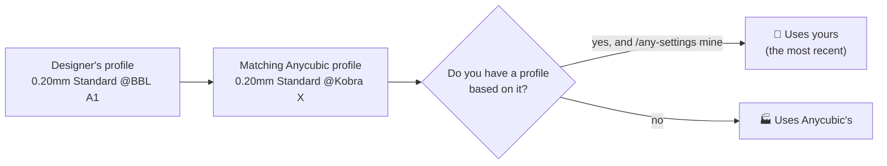
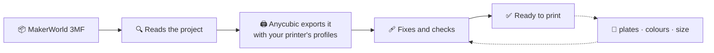

<p align="center">
  
</p>

<h1 align="center">MakerWorld to Any</h1>

<p align="center">
  <b>MakerWorld projects ready to print on your Anycubic, with one command.</b><br>
  <sub>A Claude Code skill · made by <a href="https://megatic.pt"><b>Megatic</b></a></sub>
</p>

<p align="center">
  <a href="README.pt.md"></a>
</p>

<p align="center">
  <a href="https://github.com/GodFaizT/makerworld-to-any/releases/latest"></a>
  <a href="https://github.com/GodFaizT/makerworld-to-any/actions/workflows/verificacao.yml"></a>
  
  
  
  <a href="LICENSE"></a>
  <a href="https://megatic.pt"></a>
</p>

<p align="center">
  <a href="#install"><b>Install</b></a> ·
  <a href="#first-adaptation"><b>First adaptation</b></a> ·
  <a href="#commands"><b>Commands</b></a> ·
  <a href="#after"><b>Plates and colours</b></a> ·
  <a href="#printers"><b>Printers</b></a> ·
  <a href="#profiles"><b>Profiles</b></a> ·
  <a href="#filaments"><b>Filaments</b></a> ·
  <a href="#preferences"><b>Folders and cost</b></a> ·
  <a href="#update"><b>Updating</b></a> ·
  <a href="#troubleshooting"><b>Troubleshooting</b></a> ·
  <a href="#faq"><b>FAQ</b></a>
</p>

Models on [MakerWorld](https://makerworld.com) are made in Bambu Studio for Bambu Lab printers. Opened in **Anycubic
Slicer Next** they lose their profiles, keep Bambu filaments with the wrong temperatures, switch the prime tower off
and sometimes crash the program. **MakerWorld to Any** deals with all of that through Anycubic's own command line and
checks the result by slicing it: you give it a `.3mf` and get a project that is ready to print, with the time and
grams of every plate.

<p align="center">
  
  <br><sub>What it looks like in Claude. The numbers come from a real adaptation of the example project that ships with the skill (2 plates, 2 colours).</sub>
</p>

> **A note on language.** The skill was made in Portugal. The commands, the instructions and the reports are in
> English; only the script options (`--impressora`, `--afastar`...) are in Portuguese. You don't need to type them:
> ask Claude in English and it answers in English.

<a id="get-started"></a>

## 🚀 Quick start

In a terminal (PowerShell, Command Prompt or Git Bash), **not** inside Claude Code:

```bash
npx skills add GodFaizT/makerworld-to-any --skill "*" -g -a claude-code -y
```

Or, as a plugin, inside Claude Code:

```text
/plugin marketplace add GodFaizT/makerworld-to-any
/plugin install makerworld-to-any@makerworld-to-any
```

Then open a **new** Claude Code session and type your printer's command followed by the path to the file:

```text
/kobrax "C:\Downloads\Vase.3mf"
```

`Vase - Kobra X.3mf` appears next to the original, already checked, with the time and grams of every plate. 🎉

New to this, or something didn't work? The full steps are below.

<a id="install"></a>

## 📦 Install, step by step

### 1. What you need

| | What | Why | How to check |
|---|---|---|---|
| ✅ | **Windows 10 or 11** | Anycubic Slicer Next's command line runs on Windows | — |
| ✅ | **[Claude Code](https://claude.com/claude-code)**: terminal, VS Code, or the *Code* tab of the Claude app | Claude runs the skill's scripts on your computer | `claude --version` |
| ✅ | **[Anycubic Slicer Next](https://www.anycubic.com)** 2.0 (tested with 2.0.0.3 and 2.0.0.7), in `C:\Program Files\AnycubicSlicerNext` | it exports and slices the projects | it opens normally; installed somewhere else → see [Troubleshooting](#troubleshooting) |
| ✅ | **[Python 3.8 or newer](https://www.python.org/downloads/)**, with *"Add python.exe to PATH"* ticked when installing | the scripts are Python | `python --version` |
| ➕ | `numpy` *(optional)* | measures the real gap between parts and can push them apart | `pip install numpy` |
| ➕ | `matplotlib` *(optional)* | draws the plates as an image | `pip install matplotlib` |
| ➕ | **[Node.js](https://nodejs.org)**, only for the `npx` installs | runs the installer (`npx skills` needs Node.js 22.20 or newer) | `node --version` |
| ➕ | **[Git](https://git-scm.com/download/win)**, only for `npx skills` | `npx skills` downloads the repository with Git | `git --version` |

### 2. Install: pick one way

| Way | Good for | Updates |
|---|---|---|
| **A. `npx skills`** ⭐ recommended | most people | `npx skills update` |
| **B. Claude Code plugin** | installing without leaving Claude Code | `/any-update` |
| **C. ZIP** | computers without Node.js | `/any-update` |
| **D. `npx github:`** | this project's own installer | `/any-update` |

<details open>
<summary><b>A. With <code>npx skills</code> (recommended)</b></summary>

<br>

In a terminal, **not** inside Claude Code:

```bash
npx skills add GodFaizT/makerworld-to-any --skill "*" -g -a claude-code -y
```

| Part of the command | What it means |
|---|---|
| `GodFaizT/makerworld-to-any` | this GitHub repository |
| `--skill "*"` | installs **every** skill: the main one (`makerworld-to-any`) and the commands (`/kobrax`, `/any-plates`…). The commands call the main skill, so install them together. |
| `-g` | for your user, in every project (`~/.claude/skills`). Without it, only in the current folder. |
| `-a claude-code` | for Claude Code |
| `-y` | no questions |

Prefer menus? Run `npx skills add GodFaizT/makerworld-to-any` and **select every skill** in the list.

- **Update:** `npx skills update` (use this, not `/any-update`)
- **Remove:** `npx skills remove`, then pick the MakerWorld to Any skills

</details>

<details>
<summary><b>B. As a Claude Code plugin</b></summary>

<br>

Inside Claude Code:

```text
/plugin marketplace add GodFaizT/makerworld-to-any
/plugin install makerworld-to-any@makerworld-to-any
```

- **Update:** `/any-update`, or `/plugin marketplace update makerworld-to-any` followed by
  `/plugin update makerworld-to-any@makerworld-to-any`
- **Remove:** `/plugin uninstall makerworld-to-any@makerworld-to-any`

</details>

<details>
<summary><b>C. From the ZIP (no Node.js)</b></summary>

<br>

1. Open the [latest release](https://github.com/GodFaizT/makerworld-to-any/releases/latest) and, under **Assets**,
   download `makerworld-to-any-vX.Y.Z.zip`.
2. Unzip it.
3. Double-click `instalar.bat` (*"install"*). It copies the folders to `%USERPROFILE%\.claude\skills\`.

- **Update:** `/any-update`
- **Remove:** delete these folders from `%USERPROFILE%\.claude\skills\`: `makerworld-to-any`, `anycubic`, `kobrax`,
  `kobra3`, `kobra3max`, `kobra4`, `kobras1`, `kobras1max`, `any-colors`, `any-doctor`, `any-plates`,
  `any-settings`, `any-undo`, `any-update`

</details>

<details>
<summary><b>D. With <code>npx github:</code></b></summary>

<br>

```bash
npx github:GodFaizT/makerworld-to-any                 # every project (~/.claude/skills)
npx github:GodFaizT/makerworld-to-any --projeto       # only the current folder (./.claude/skills)
npx github:GodFaizT/makerworld-to-any --verificar     # only check Python and Anycubic Slicer Next
npx github:GodFaizT/makerworld-to-any --desinstalar   # remove
```

- **Update:** `/any-update`, or run the first command again

</details>

<details>
<summary><b>And the claude.ai chat?</b></summary>

<br>

Upload `makerworld-to-any-skill.zip` (from the [releases](https://github.com/GodFaizT/makerworld-to-any/releases/latest))
under **Settings → Capabilities → Skills**. The chat runs on a server without Anycubic Slicer Next, so Claude can
explain and advise there, but it **cannot adapt or slice**. Use Claude Code for that.

</details>

### 3. Check that it works

1. **Close Claude Code and open a new session.** Skills are only loaded when a session starts.
2. Type `/` and look for `/kobrax`, `/any-plates`… in the list.
3. Run the self-test:
   ```text
   /any-doctor test
   ```
   In under a minute it checks Python, Anycubic Slicer Next and the profiles, then adapts, recolours, rearranges and
   slices an example project. If something is missing it says what. The [Troubleshooting](#troubleshooting) section has
   the usual fixes.

<a id="first-adaptation"></a>

## 🧭 Your first adaptation, step by step

1. **Get the project file.** On the model's MakerWorld page, download the **3MF** of the print profile you want. It
   must be the project `.3mf`, **not** a `.gcode.3mf`: that one is already sliced and has no model left to adapt.
2. **Copy its path.** In File Explorer, right-click the file → **Copy as path** (or select it and press
   `Ctrl` + `Shift` + `C`). You get the path with its quotes, e.g. `"C:\Downloads\Vase.3mf"`.
3. **Ask Claude Code.** Type your printer's command and paste the path:
   ```text
   /kobrax "C:\Downloads\Vase.3mf"
   ```
   You can add requests in plain words: `/kobrax "C:\Downloads\Vase.3mf" 12 cm tall, in PETG`.
4. **Wait 1 to 3 minutes.** The skill reads the project, has Anycubic Slicer Next export it with your printer's
   profiles, fixes what Anycubic's command line gets wrong, checks the dimensions and slices every plate. Claude may
   ask permission to run `python`: allow it.
5. **Read the answer.** It tells you:
   - where the new file is, and for which printer;
   - the print profile and what came from the designer (supports, infill, layer height…);
   - the filaments and colours and, with an ACE, **which colour goes in which slot**;
   - for each plate: what is on it, the time and the grams;
   - the estimated cost (if you saved your prices) and any warnings, with what to do about them.
6. **Print.** Open the new file in Anycubic Slicer Next, look at the preview, check the ACE slots match the filaments
   (filament 1 → slot 1, and so on) and send it to the printer.

**Where the new file goes**

| Situation | The adapted file goes to |
|---|---|
| you saved an adapted-files folder with `/any-settings` | that folder |
| there is an `Adaptado <printer>` folder (e.g. `Adaptado Kobra X`) next to the original or in its parent folder | that folder |
| otherwise | next to the original |

The name is always `<original> - <printer>.3mf`, e.g. `Vase - Kobra X.3mf`. **The original is never modified.**

<a id="commands"></a>

## ⚡ Commands

Type the command, the path to the `.3mf` (or to a **folder**, to adapt every file in it) and, if you like, anything
else you want in plain words.

| Command | What it does |
|---|---|
| `/kobrax <file>` | adapt for the Anycubic **Kobra X** |
| `/kobra4` · `/kobras1` · `/kobras1max` · `/kobra3` · `/kobra3max` | the same for the **Kobra 4**, **S1**, **S1 Max**, **Kobra 3** and **3 Max** |
| `/anycubic <printer> <file>` | any other: Kobra 2 Neo, Kobra 3 V2, Kobra 1… |
| `/any-plates <adapted file>` | arrange the **plates**: move objects, one per plate, merge, push parts apart |
| `/any-colors <adapted file>` | **colours** per part, add a colour, change colours or the material |
| `/any-undo [file]` | **undo**: restore the previous version of a file |
| `/any-settings` | **preferences**: your profiles, your printer, folders and prices |
| `/any-doctor [test]` | check that everything works (`test` = full self-test) |
| `/any-update` | update the skill and its commands |

```text
/kobrax "C:\Downloads\Vase.3mf"
/kobras1 "C:\Downloads\Vase.3mf" 12 cm tall, in gold PLA Silk
/kobrax "C:\Downloads\Vase.3mf" with my own profiles
/kobrax "C:\Downloads\Vase.3mf" in PETG and keep the g-code
/kobra3max "C:\Downloads\MakerWorld"                  ← every .3mf in the folder
/anycubic Kobra 2 Neo "C:\Downloads\Vase.3mf" 0.6 nozzle
```

You can also just ask: *"convert this file for my Kobra X"*, *"make the vase 10 cm tall"*, *"put the body on one plate
and the lid on another"*, *"the name in blue and the rest in white"*, *"how long does this take?"*.

<a id="after"></a>

## 🧰 After adapting: plates, colours, size

An adapted project can be reworked without going back to the original. Every change is sliced again, so you know the
time and grams, and a copy of the previous file is always kept.

<p align="center">
  
  <br><sub>What the skill sees: the real outline of each part (not its bounding box), the prime tower, and the time and grams of each plate.</sub>
</p>

**Plates** — `/any-plates`

```text
/any-plates "C:\…\Vase - Kobra X.3mf"                                 ← what is on each plate
/any-plates "C:\…\Vase - Kobra X.3mf" the body on one plate and the lid on another
/any-plates "C:\…\Vase - Kobra X.3mf" one object per plate
/any-plates "C:\…\Vase - Kobra X.3mf" everything on one plate, 6 mm apart
```

The skill measures the **real gap** between parts from their shape. It warns when two parts are less than 2 mm apart
(they may fuse on the first layer) and can push them apart. The prime tower always goes somewhere that is actually
free.

**Colours per part** — `/any-colors`

```text
/any-colors "C:\…\Sign - Kobra X.3mf"                                  ← filament of every object and part
/any-colors "C:\…\Sign - Kobra X.3mf" the name in navy and the rest in white
/any-colors "C:\…\Sign - Kobra X.3mf" filament 2 in burgundy
/any-colors "C:\…\Sign - Kobra X.3mf" in PETG
```

You can move a part to another filament, add a colour the project didn't have, or just change the colours. The **purge
volumes are recalculated** for the new colours (navy to white needs three times the purge of white to navy): Anycubic's
command line does not do this and would keep the volumes of the old colours.

**Size** — ask in the command or afterwards: *"10 cm tall"*, *"same height as the other one"*, *"half size"*. Each
object grows around its own centre and stays on the bed.

**Undo** — `/any-undo`

```text
/any-undo                                 ← list the saved copies
/any-undo "C:\…\Vase - Kobra X.3mf"       ← restore the previous version
```

Before replacing a file the skill saves it (the last 30 copies, in `%APPDATA%\makerworld-to-any\copias`). Your
originals are never modified.

<a id="printers"></a>

## 🖨 Printers

| Printer | Bed (mm) | Nozzles | Colours |
|---|---|---|---|
| **Kobra X** | 260 × 260 × 260 | 0.25 · 0.4 · 0.6 · 0.8 | 🌈 ACE |
| **Kobra 4** | 260 × 260 × 260 | 0.25 · 0.4 · 0.6 · 0.8 | 🌈 ACE |
| **Kobra S1** | 250 × 250 × 250 | 0.25 · 0.4 · 0.6 · 0.8 | 🌈 ACE |
| **Kobra S1 Max** | 350 × 350 × 350 | 0.25 · 0.4 · 0.6 · 0.8 | 🌈 ACE |
| **Kobra 3** · 3 V2 | 255 × 255 × 260 | 0.2 · 0.4 · 0.6 · 0.8 | 🌈 ACE |
| **Kobra 3 Max** · 3 Max V2 | 426 × 420 × 501 | 0.4 · 0.6 · 0.8 | 🌈 ACE |
| Kobra 2 · 2 Neo · 2 Pro | 220 × 220 × 250 | 0.4 | single colour |
| Kobra 2 Plus · 2 Max | 320³ · 426³ | 0.4 | single colour |
| Kobra 1 · 1 Plus · 1 Max | 220 · 300 · 400 | 0.4 | single colour |

The list comes from the Anycubic Slicer Next you have installed. Without an ACE, a multi-colour model becomes a
single-filament project and the skill tells you the colour the designer gave each object, so you can swap the spool
between plates.

<a id="profiles"></a>

## 🎛 Profiles: Anycubic's or your own

Every adaptation uses **three profiles** from Anycubic Slicer Next:

| Profile | What it sets | Example |
|---|---|---|
| 🖨 **Printer** | bed, nozzle, start and end g-code, filament changes | `Anycubic Kobra X 0.4 nozzle` |
| 🧱 **Print** | layer height, walls, infill, speeds, supports, seam | `0.20mm Standard @Anycubic Kobra X 0.4 nozzle` |
| 🧵 **Filament** | temperatures, cooling, retraction, flow, maximum speed | `Anycubic PLA Matte @Anycubic Kobra X 0.4 nozzle` |

### Two ways to work

<table>
<tr>
<th width="50%">🏭 Anycubic's profiles <i>(default)</i></th>
<th width="50%">🙋 Your own profiles</th>
</tr>
<tr valign="top">
<td>

The official profiles that come with Anycubic Slicer Next, tuned by Anycubic for each printer, nozzle and filament.
You don't have to do anything: this is what the skill uses unless you say otherwise.

</td>
<td>

The profiles you tuned and saved in Anycubic Slicer Next (seam at the back, more walls, your PLA at another
temperature…). The skill uses yours whenever you have one based on the profile it picked, and Anycubic's otherwise.

</td>
</tr>
</table>

### Using your own profiles, step by step

1. **Create your profile in Anycubic Slicer Next.** Pick the printer and the profile you want to tune (e.g.
   `0.20mm Standard`), change what you like and click the **save** icon. Give it your own name (e.g. *"0.20 Mine"*).
   Filaments work the same way: open, say, `Anycubic PLA Matte`, tune the temperature and save it under another name.
2. **Check that the skill sees it:**
   ```text
   /any-settings
   ```
   It lists your profiles and marks the ones that fit your printer with *"← para a tua impressora"* (for your printer).
3. **Choose to use them:**
   ```text
   /any-settings mine                                 ← always, from now on
   /kobrax "C:\…\Vase.3mf" with my own profiles     ← just this once
   ```
4. **Adapt as usual.** The report says which profiles were used and marks yours as *"your profile, based on …"*
   (your profile, based on …).

To go back to Anycubic's: `/any-settings anycubic`.

> 💡 **Tip:** almost every MakerWorld model is made at **0.20 mm**. If you want your settings on nearly everything,
> base your profile on your printer's `0.20mm Standard`.

### How the skill chooses



### Who decides what

| Settings | Where they come from |
|---|---|
| Speeds, accelerations, temperatures, retraction, cooling | the chosen profile (Anycubic's or yours) — never Bambu's |
| Supports, infill, walls, ironing, fuzzy skin, vase mode | the **model's designer**, because the model was designed that way |
| What you changed in your own profile (seam, arachne…) | **you**: it wins over values the designer only had by default |
| Layer height | the designer's; if you pick the profile yourself ("with 0.12"), that profile's |
| Speeds the designer changed | only pass when they are **lower** than your printer's profile |
| The designer's variable layer heights | kept (the report tells you the real average height); *"without variable layers"* ignores them |

The report separates what the designer **changed on purpose**, what came from **their base profile**, and what **was
not carried over** and why (it belongs to their printer, it doesn't exist in Anycubic's slicer, or it is a speed above
your profile).

### Priorities

What you ask for in the command wins over everything; then environment variables, then `/any-settings`, and finally
the Kobra X with Anycubic's profiles.

```text
/kobrax "C:\…\Vase.3mf"                          ← uses what is set in /any-settings
/kobrax "C:\…\Vase.3mf" with my own profiles     ← yours, just this once
/kobrax "C:\…\Vase.3mf" with 0.16 high quality   ← another print profile
```

The `/any-settings` choice is stored outside the skill folder, so `/any-update` keeps it. Your profiles are only ever
read: the skill never writes to Anycubic's folder.

<a id="filaments"></a>

## 🧵 Filaments: each material gets its own profile

The skill looks at the material of each of the designer's filaments and picks the profile **for that material** on
your printer, with the right temperatures, cooling, retraction and maximum speed. The designer's colours are kept.

| Designer's material (Bambu) | Becomes (if your printer has it) | Notes |
|---|---|---|
| PLA Basic, Generic PLA | Anycubic PLA | |
| PLA Matte · Silk · Wood · Glow · Translucent · Marble · Galaxy/Sparkle · Metal | the matching Anycubic variant | plain PLA if the printer lacks it |
| PLA Tough / PLA+ | Anycubic PLA+ | |
| PLA-CF | Anycubic PLA-CF | 🔩 hardened nozzle |
| PETG (Basic, HF, Translucent) | Anycubic PETG | |
| PETG-CF · PET-CF | Anycubic PETG-CF · PET-CF | 🔩 hardened nozzle |
| PCTG | Anycubic PETG | ⚠️ warns |
| ABS · ASA | Anycubic ABS · ASA | 📦 enclosed printer |
| PC · PC-CF · PC-GF | Anycubic PC · PC-CF · PC-GF | 📦 enclosed printer |
| PA · PA6-CF · PAHT-CF | Anycubic PA · PA6-CF · PAHT-CF | 📦 enclosed · 🔩 hardened nozzle |
| TPU 95A | Anycubic TPU 95A / TPU | 🌀 external spool |
| TPU for AMS | Anycubic TPU for ACE | 🌀 can go through the ACE |
| PVA | Anycubic PVA | 💧 keep it dry |
| Support for PLA | Anycubic PLA | ⚠️ warns (it was a support-only material) |

**If your printer has no profile for the material** (PC on the Kobra X, ASA on the Kobra 1…) the skill uses the
closest one and **always warns you**. It never swaps materials silently. What is available varies a lot: the S1 Max
has PA, PC and fibre-filled filaments, while the Kobra 1 only has Generic PLA, PETG and ABS.

**Change the material** — ask in the command and the colours stay:

```text
/kobrax "C:\…\Vase.3mf" in PETG
/kobras1 "C:\…\Vase.3mf" in PLA Silk
/kobras1max "C:\…\Bracket.3mf" in PA6-CF
```

**Using your own filament profile:** save it in Anycubic Slicer Next from Anycubic's profile for that material (e.g.
your *"Black PETG"* based on `Anycubic PETG`) and use `/any-settings mine`. The skill uses it whenever the material
matches.

<a id="preferences"></a>

## 📁 Folders and the cost of each job

`/any-settings` also stores where you want your files and what printing costs you:

```text
/any-settings save adapted files in D:\Prints\Adapted and originals in D:\Prints\Originals
/any-settings PLA is 18 euros a kilo, PETG 20, the machine 40 cents an hour
```

- **Adapted folder** — everything you adapt goes there (put `{impressora}` in the path for one folder per printer).
- **Originals folder** — an original dropped in the folder above it is tidied away there once adapted.
- **Prices** — per kilo of each material and per machine hour. The report then includes the **estimated cost** of each
  job (filament + hours), as in the image at the top.

Without any of this the skill works as before: the adapted file goes next to the original (or into an
`Adaptado <printer>` folder, if there is one) and the report shows no cost.

## ✨ What it does for you

| | |
|---|---|
| 🎯 **The right profile** | Your printer's profile with the same name as the designer's (`0.20mm Standard @BBL A1` → `0.20mm Standard @Anycubic Kobra X`) |
| 🎨 **Filaments and colours** | Works out which filaments the model *really* uses and picks each material's profile for your printer (PLA, PETG, ABS, TPU, CF…), keeping the designer's colours; warns if your printer lacks the material |
| 🗼 **Prime tower and purge** | Turns the prime tower on when there are colours, places it somewhere free on every plate, and recalculates the purge volumes when colours change |
| 🧩 **Nothing lost** | Plates, parts, modifiers, colour painting, fuzzy skin, variable layer heights and the designer's credits |
| 🩹 **Anycubic's bugs** | Works around the known crashes and mistakes of Anycubic's command line |
| 📏 **Size, plates and colours** | "10 cm tall", "one per plate", "the name in blue and the rest in white" |
| 📐 **Real gaps** | Measures the distance between parts from their shape and warns about parts that may fuse |
| ✅ **Verified** | Same dimensions as the original, everything inside the bed, and every plate sliced |
| ↩️ **Nothing to fear** | Keeps a copy before replacing a file; `/any-undo` restores it |
| 💶 **Cost** | With your prices, the estimated cost of each job |
| 🧷 **End of print** | Where the stock end g-code leaves the nozzle resting on the part (Kobra X, 4, S1 Max), it lifts it 5 mm |



<a id="update"></a>

## 🔄 Updating and diagnostics

How you update depends on how you installed:

| Installed with | Update with |
|---|---|
| `npx skills` | `npx skills update` (in a terminal) |
| Claude Code plugin | `/any-update` (or `/plugin update makerworld-to-any@makerworld-to-any`) |
| ZIP or `npx github:` | `/any-update` |

Then open a new Claude Code session. What changed in each version is in the [CHANGELOG](CHANGELOG.md).

```text
/any-doctor         ← Python, Anycubic Slicer Next, profiles and preferences
/any-doctor test    ← adapts, changes colours, rearranges plates and slices an example project
```

After updating **Anycubic Slicer Next**, run `/any-doctor test`: the skill was tested with versions 2.0.0.3 and
2.0.0.7, and the self-test tells you whether everything still works with yours.

<a id="troubleshooting"></a>

## 🩺 Troubleshooting

| Problem | What to do |
|---|---|
| `/kobrax` doesn't show up in Claude Code | Open a **new** session. Still missing? Check the skills are installed (`npx skills list`, `/plugin`, or the folders in `~/.claude/skills`). With `npx skills`, install **every** skill (`--skill "*"`): the commands don't work without the main skill. |
| `npx skills` fails with *"Failed to clone repository"* … `spawn git ENOENT` | That terminal can't find Git. Install [Git](https://git-scm.com/download/win) if `git --version` fails. If Git is already installed, **close the terminal, open a new one** and run the command again. |
| *"Anycubic Slicer Next not found"* | Install it. If it lives in another folder, point the skill at the program and open a new terminal:<br>`setx ANYCUBIC_SLICER "D:\Apps\AnycubicSlicerNext\AnycubicSlicerNext.exe"` |
| *"Python not found"*, or `python` opens the Microsoft Store | Install Python from [python.org](https://www.python.org/downloads/) with *"Add python.exe to PATH"* ticked. Then in Windows go to **Settings → Apps → Advanced app settings → App execution aliases** and switch off the `python.exe` and `python3.exe` aliases. |
| The file is not found | Put the path in **double quotes**, especially when it has spaces or accents. **Copy as path** in File Explorer does it for you. |
| *".gcode.3mf"* or *"no model"* | That file is already sliced. Download the project `.3mf` from MakerWorld instead. |
| Warning: parts less than 2 mm apart | They may fuse on the first layer: `/any-plates "<adapted file>" push the parts 6 mm apart` |
| The model doesn't fit the bed | Scale it (*"18 cm tall"*), split it across plates (`/any-plates`) or pick a bigger printer. |
| It worked before, it fails after updating Anycubic Slicer Next | Run `/any-doctor test` and open an [issue](https://github.com/GodFaizT/makerworld-to-any/issues) with what it says. |
| Anything else | Run `/any-doctor test` and open an [issue](https://github.com/GodFaizT/makerworld-to-any/issues) with the report. You don't need to send your model. |

<a id="faq"></a>

## ❓ FAQ

<details>
<summary><b>Does it work in the claude.ai chat or only in Claude Code?</b></summary>

<br>It has to run Anycubic Slicer Next on your computer, so it adapts in **Claude Code** (terminal, VS Code, or the
*Code* tab of the Claude app for Windows). In the claude.ai chat the skill can only explain and advise.
</details>

<details>
<summary><b>My printer has no ACE and the model has several colours</b></summary>

<br>On the Kobra 1 and 2 the project gets a single filament (no change commands the printer can't run) and the skill
tells you the colour the designer gave each object, so you can swap the spool between plates.
</details>

<details>
<summary><b>The model doesn't fit my bed</b></summary>

<br>The skill warns you. Ask it to scale down (*"18 cm tall"*), split the parts across plates (`/any-plates`), or pick
a bigger printer.
</details>

<details>
<summary><b>Does it touch my profiles or my files?</b></summary>

<br>Your profiles are only read: the skill never writes to Anycubic's folder. Originals are never modified (they only
change folder if you set an originals folder). When an adapted file is replaced a copy is kept, and `/any-undo`
brings it back.
</details>

<details>
<summary><b>Can I print the saved g-code directly?</b></summary>

<br>With *"keep the g-code"* you get each plate's g-code exactly as Anycubic Slicer Next sliced it. The recommended
route is still to open the `.3mf` in Anycubic Slicer Next and send it from there: you see the preview and the ACE
slots get mapped. Printing the g-code directly is for people who know what they are doing.
</details>

<details>
<summary><b>What does the estimated cost include?</b></summary>

<br>The grams of each filament at the price per kilo you saved, plus the print hours at your hourly price. Failed
prints, electricity or your own time only count if you put them in the hourly price.
</details>

<details>
<summary><b>What about the models' credits and licences?</b></summary>

<br>The skill keeps the original designer's credits in the project. The models still belong to their designers:
respect each licence (many are for personal use only).
</details>

<details>
<summary><b>Can I use it without Claude?</b></summary>

<br>Yes, the scripts are plain Python (`numpy` and `matplotlib` are optional). Option names are Portuguese:

```bash
cd skills/makerworld-to-any/scripts
python adaptar.py --listar-impressoras                           # list printers
python adaptar.py "Model.3mf"                                    # → Model - Kobra X.3mf
python adaptar.py "Model.3mf" --impressora "Kobra S1" --perfis meus --gcode gcode
python escalar.py "Model - Kobra X.3mf" --altura 120 --fatiar    # 120 mm tall, then slice; keeps a copy
python pratos.py "Model - Kobra X.3mf" --mover "body=1;lid=2" --fatiar
python pratos.py "Model - Kobra X.3mf" --afastar 6 --fatiar      # at least 6 mm between parts
python cores.py "Model - Kobra X.3mf" --atribuir "lid=2" --cores ";#232C7C"
python medir.py "Model - Kobra X.3mf" --fatiar --imagem plates.png
python desfazer.py "Model - Kobra X.3mf"                         # undo
python perfil.py meus --impressora "Kobra X" --preco-kg "PLA=18;*=22" --preco-hora 0.40
python diagnostico.py --teste                                    # self-test
python exemplo.py Example.3mf                                    # the example project used in the images above
```

| `adaptar.py` option | meaning |
|---|---|
| `--impressora "Kobra S1"` · `--bico 0.6` | target printer and nozzle |
| `--perfis sistema\|meus` | Anycubic's profiles or yours |
| `--processo "0.16mm High Quality"` | another print profile (one of yours too, by name) |
| `--material PETG` | change the material of every filament (colours stay) |
| `--filamentos "Anycubic PLA Matte;Anycubic PLA"` · `--cores "#FFFFFF;#800020"` | filament profiles and colours, in order |
| `--atribuir "lid=2;1.3=2"` | filament of objects and parts |
| `--sem-camadas-variaveis` | ignore the designer's variable layer heights |
| `--gcode FOLDER` | also save each plate's g-code |
| `--manter-gcode` | in an already adapted project, keep the g-code it carries (only if it is yours) |
| `--saida FOLDER` · `--nome FILE` · `--substituir` | where to save · file name · overwrite (keeps a copy) |
| `--arquivar-original FOLDER` | move the original there at the end |
| `--sem-fatiar` · `--json` · `--manter-temp` | export only · JSON report · keep the temporary folder |

Preferences (`/any-settings` or `perfil.py`) live in `%APPDATA%\makerworld-to-any\config.json`. Environment variables
(they win over preferences): `MAKERWORLD_TO_ANY_IMPRESSORA`, `MAKERWORLD_TO_ANY_PERFIS` (`sistema` or `meus`),
`ANYCUBIC_SLICER` (path to the executable).
</details>

<details>
<summary><b>What was it tested with?</b></summary>

<br>Projects made for the Bambu Lab **A1**, **A1 mini** and **P1S/X1C**, with 1 to 4 plates, up to 5 filaments,
painted fuzzy skin, variable layer heights and cut parts, adapted for the **Kobra X** (results identical to
adaptations done by hand), with Anycubic's profiles and with user profiles. The end-to-end self-test
(`/any-doctor test`) passes on the **Kobra X** (0.4 and 0.6 nozzles), **Kobra 4**, **S1**, **S1 Max**,
**Kobra 3**, **3 Max**, **Kobra 2 Neo**, **2 Max** and **Kobra 1**. That test runs in the slicer (the project opens
and slices without errors); the printer Megatic prints on is the Kobra X.
</details>

<details>
<summary><b>I want to work on the code</b></summary>

<br>

The scripts are plain Python in [`skills/makerworld-to-any/scripts`](skills/makerworld-to-any/scripts), and each
command is a small `SKILL.md` in `skills/<command>/`. Technical notes on Anycubic's command line are in
[`skills/makerworld-to-any/referencia/notas.md`](skills/makerworld-to-any/referencia/notas.md).
Bugs and ideas are welcome in the [issues](https://github.com/GodFaizT/makerworld-to-any/issues).
</details>

---

<p align="center">
  <br>
  <a href="https://megatic.pt"></a>
  <br><br>
  Made with ❤️ in Portugal by <a href="https://megatic.pt"><b>Megatic</b></a><br>
  <sub>An independent project, not affiliated with Bambu Lab, Anycubic or MakerWorld · MIT licence</sub>
</p>
