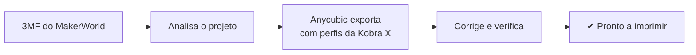

<p align="center">
  
</p>

<h1 align="center">MakerWorld to Any</h1>

<p align="center">Feito pela <a href="https://megatic.pt"><b>Megatic</b></a> · <a href="https://megatic.pt">megatic.pt</a></p>

<p align="center">
  <a href="#instalação"></a>
  
  
  
  <a href="LICENSE"></a>
  <a href="https://megatic.pt"></a>
</p>

<p align="center">
  <b>Dás-lhe um 3MF do MakerWorld e recebes um projeto da Anycubic Kobra X pronto a imprimir,<br>
  já fatiado, com tempo e gramas de cada prato.</b>
</p>

---

Os modelos do [MakerWorld](https://makerworld.com) vêm feitos no Bambu Studio para impressoras Bambu Lab. Abrir esses
projetos no **Anycubic Slicer Next** perde perfis, deixa filamentos da Bambu com temperaturas erradas, desliga a torre
de purga e, às vezes, até faz o programa rebentar. Esta skill do [Claude Code](https://claude.com/claude-code) trata
disso tudo com a linha de comandos do próprio Anycubic e confirma o resultado fatiando.

```text
Tu      › adapta este ficheiro para a kobra x: C:\Downloads\Anjo.3mf
Claude  › Ficou em Adaptado Kobra X\Anjo - Kobra X.3mf (perfil 0.20mm Standard, 2 cores):
          • prato 1 — corpo: 5h54, 92 g (PLA Matte bege, ranhura 2)
          • prato 2 — asas: 17 min, 8,3 g (PLA Matte branco, ranhura 1)
          O autor tinha suportes só nas zonas críticas e 5 % de enchimento; passei as duas coisas.
```

## O que faz

| | O que faz |
|---|---|
| 🎯 **Perfil certo** | Usa o perfil da Kobra X equivalente ao do autor (`0.20mm Standard @BBL A1` → `0.20mm Standard @Anycubic Kobra X`) e passa só o que o autor mudou e importa: suportes, enchimento, paredes, ironing, fuzzy skin, costura, modo vaso… Ignora o que é da impressora dele (acelerações, g-code, posição da torre). |
| 🎨 **Filamentos e cores** | Descobre que filamentos o modelo usa *mesmo* (projetos do MakerWorld trazem muitas vezes 4–5 que não servem para nada), troca-os pelos Anycubic equivalentes (Matte → PLA Matte, Silk → PLA Silk, PETG → PETG…) e mantém as cores do autor. |
| 🗼 **Torre de purga** | Liga-a quando há várias cores e põe-na num sítio livre de cada prato, longe das peças. |
| 🧩 **Tudo o resto intacto** | Pratos, peças, modificadores, pintura de cores, fuzzy skin pintado, alturas de camada variáveis e os créditos do autor. |
| 🩹 **Bugs do Anycubic** | Contorna os crashes e erros conhecidos da linha de comandos (nomes de prato, listas de filamentos, matriz de purga, definições alteradas). |
| 📏 **Tamanhos** | "Mete com 10 cm", "do tamanho da outra peça", "a 52 %": escala à volta do centro, assenta na mesa e reposiciona a torre. |
| ✂️ **Separar pratos** | "Faz um ficheiro só com o anjo pequeno" → só os pratos pedidos, renumerados. |
| ✅ **Verificado** | Confere que as medidas são iguais ao original e que tudo cabe na mesa de 260 mm, e fatia todos os pratos para dar tempo, gramas por cor e trocas de cor. |
| 🧷 **Fim de impressão melhor** | O g-code de fábrica deixa o bico pousado na peça a arrefecer (fio e bolinha no topo); este levanta 5 mm e afasta a cabeça. |



## Instalação

Precisas do **[Claude Code](https://claude.com/claude-code)**, do **Anycubic Slicer Next** (testado com a 2.0.0.3,
em `C:\Program Files\AnycubicSlicerNext`) e do **[Python 3](https://www.python.org/downloads/)**. Escolhe uma das
formas:

### 1. Plugin do Claude Code (recomendado)

Dentro do Claude Code:

```text
/plugin marketplace add GodFaizT/makerworld-to-any
/plugin install makerworld-to-any@makerworld-to-any
```

Atualizar mais tarde: `/plugin update makerworld-to-any@makerworld-to-any`.

### 2. `npx skills`

```bash
npx skills add GodFaizT/makerworld-to-any
```

### 3. Instalador `npx`

```bash
npx github:GodFaizT/makerworld-to-any              # para todos os projetos (~/.claude/skills)
npx github:GodFaizT/makerworld-to-any --projeto    # só no projeto atual (./.claude/skills)
npx github:GodFaizT/makerworld-to-any --verificar  # verifica Python e Anycubic Slicer Next
npx github:GodFaizT/makerworld-to-any --desinstalar
```

### 4. À mão

Descarrega o ZIP do repositório (botão verde **Code → Download ZIP**) e copia a pasta
`skills/makerworld-to-any` para `%USERPROFILE%\.claude\skills\`.

### 5. App do Claude (desktop e claude.ai)

| Onde | Funciona? | Como |
|---|---|---|
| **App Claude para Windows → separador _Code_** | ✅ Tudo | É o Claude Code dentro da app e corre no teu PC. Instala o plugin (forma 1) ou a skill (formas 2–4); a app usa as mesmas skills e plugins. |
| **Chat da app / claude.ai** | ⚠️ Só conversa | Descarrega `makerworld-to-any-skill.zip` das [releases](https://github.com/GodFaizT/makerworld-to-any/releases/latest) e carrega-o em **Definições → Capacidades → Skills**. O chat corre num servidor da Anthropic, sem o Anycubic Slicer Next: o Claude explica e planeia, mas não consegue exportar nem fatiar. Para adaptar ficheiros usa o separador _Code_. |

Depois de instalar, abre uma sessão nova do Claude Code.

## Como usar

Fala normalmente com o Claude. Funciona em português e em inglês:

| Pedes | Acontece |
|---|---|
| `adapta para a kobra x: C:\...\Vaso.3mf` | adapta, fatia e diz tempo e gramas de cada prato |
| `adapta com PLA Silk dourado` | troca o filamento e a cor |
| `mete o vaso com 12 cm` | escala para 12 cm de altura e fatia outra vez |
| `põe do tamanho do outro ficheiro` | mede o outro e iguala a altura |
| `faz um ficheiro só com os pratos 3 e 4` | separa os pratos |
| `quanto tempo demora este?` | fatia e resume |

Também podes chamar a skill diretamente com `/makerworld-to-any`.

### Sem o Claude

Os scripts são Python simples (só a biblioteca padrão; o `numpy` acelera, mas é opcional):

```bash
cd skills/makerworld-to-any
python scripts/adaptar.py "Modelo.3mf"                      # → Modelo - Kobra X.3mf + relatório
python scripts/adaptar.py "Modelo.3mf" --filamentos "Anycubic PLA Silk" --cores "#D4AF37"
python scripts/escalar.py "Modelo - Kobra X.3mf" "Modelo 12cm.3mf" --altura 120 --fatiar
python scripts/separar_pratos.py "Projeto.3mf" "Só pratos 3-4.3mf" 3,4
python scripts/medir.py "Modelo - Kobra X.3mf" --fatiar
```

<details>
<summary><b>Todas as opções do <code>adaptar.py</code></b></summary>

| opção | para que |
|---|---|
| `--saida PASTA` | pasta de saída (por omissão: `Adaptado Kobra X` ao lado do original, se existir) |
| `--nome FICHEIRO` | nome do ficheiro de saída (por omissão `<original> - Kobra X.3mf`) |
| `--substituir` | substitui o ficheiro de saída se já existir |
| `--arquivar-original PASTA` | move o original para essa pasta no fim |
| `--processo "0.16mm High Quality"` | força outro perfil da Kobra X |
| `--filamentos "A;B"` | perfis de filamento Anycubic por ordem |
| `--cores "#FFFFFF;#800020"` | cores por ordem |
| `--sem-fatiar` | só exporta (rápido) |
| `--manter-temp` | guarda a pasta temporária para investigar |

Variáveis de ambiente: `ANYCUBIC_SLICER` (caminho do executável) e `ANYCUBIC_PERFIS` (pasta dos perfis de sistema).
</details>

## Testado com

- Projetos para **A1**, **A1 mini** (mesa de 180) e **P1S/X1C** (mesa de 256)
- 1 a 4 pratos por projeto, até 5 filamentos (com só 2 em uso)
- Peças multicor por objeto, **fuzzy skin pintado**, **alturas de camada variáveis**, peças cortadas com conectores
- Os resultados fatiados coincidem com adaptações feitas à mão no Anycubic Slicer Next (mesmo tempo e gramas)

## Limitações

- Feito e testado em **Windows**. Os perfis vêm de `%APPDATA%\AnycubicSlicerNext`; noutros sistemas define
  `ANYCUBIC_SLICER` e `ANYCUBIC_PERFIS`.
- Só **bico 0.4**. Se o original for para outro bico, a skill avisa.
- Uma ACE tem **4 ranhuras**: com mais cores, avisa.
- Ficheiros `.gcode.3mf` (já fatiados, sem modelo) não dão para adaptar.
- Modelos maiores que 260 mm são assinalados. Podes reduzi-los com `escalar.py` ou arrumá-los no Anycubic.

## Créditos e aviso

Projeto independente, sem ligação à Bambu Lab, à Anycubic nem ao MakerWorld. Os modelos continuam a ser dos seus
autores: respeita a licença de cada modelo (muitos são só para uso pessoal). A skill mantém no projeto os créditos
do autor original.

---

<details>
<summary><b>🇬🇧 English</b></summary>

**MakerWorld to Any** (`makerworld-to-any`) is a [Claude Code](https://claude.com/claude-code) skill that converts Bambu Studio /
MakerWorld 3MF projects into ready-to-print **Anycubic Kobra X** projects for Anycubic Slicer Next.
It runs the slicer's own command line and does the following:
- maps the designer's profile and changes;
- detects which filaments are actually used and maps them to Anycubic profiles, keeping the colours;
- fixes the CLI's known bugs and places the prime tower;
- keeps plates, modifiers, colour/fuzzy-skin painting and variable layer heights;
- slices every plate to report time and grams.

It can also resize models, split plates and measure projects.

Install it with `/plugin marketplace add GodFaizT/makerworld-to-any`, `npx skills add GodFaizT/makerworld-to-any`
or `npx github:GodFaizT/makerworld-to-any`. Then ask Claude to *"convert this 3MF for the Kobra X"*.
The prompts and reports are in Portuguese, but Claude answers in your language.

Made by [Megatic](https://megatic.pt).
</details>

<p align="center">
  <a href="https://megatic.pt"><b>Megatic</b></a> — feito com ❤️ em Portugal · <a href="https://megatic.pt">megatic.pt</a><br>
  <sub>Licença MIT</sub>
</p>
