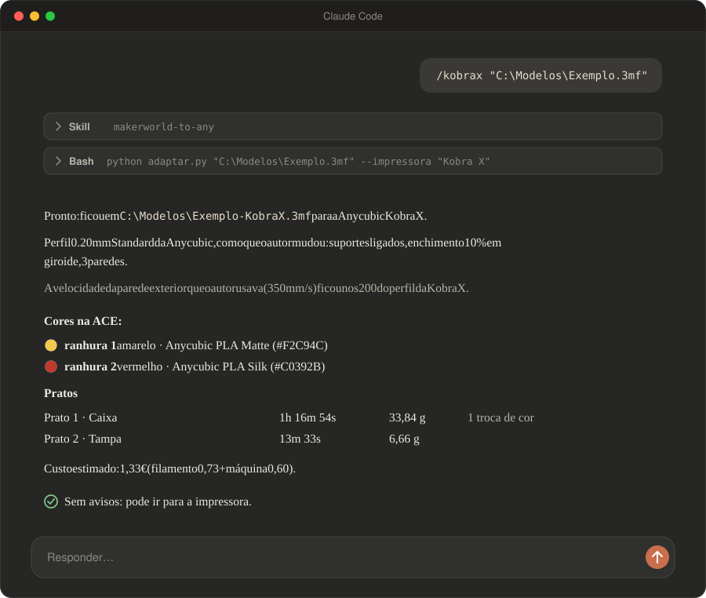
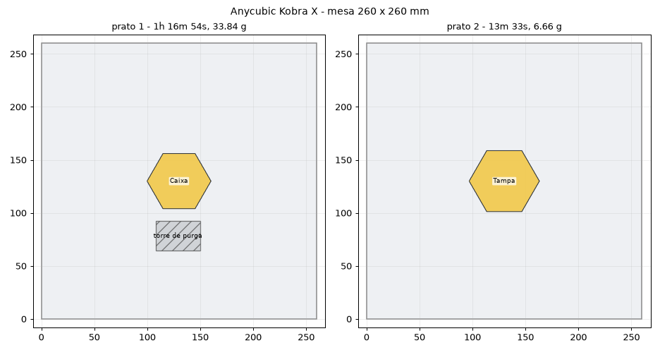
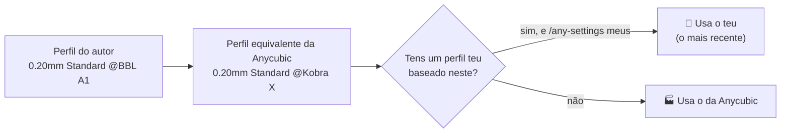
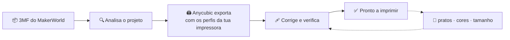

<p align="center">
  
</p>

<h1 align="center">MakerWorld to Any</h1>

<p align="center">
  <b>Projetos do MakerWorld prontos a imprimir na tua Anycubic, com um comando.</b><br>
  <sub>Skill para o Claude Code, o Codex (ChatGPT) e o Antigravity (Gemini) · feita pela <a href="https://megatic.pt"><b>Megatic</b></a></sub>
</p>

<p align="center">
  <a href="README.md"></a>
</p>

<p align="center">
  <a href="https://github.com/GodFaizT/makerworld-to-any/releases/latest"></a>
  <a href="https://github.com/GodFaizT/makerworld-to-any/actions/workflows/verificacao.yml"></a>
  
  
  
  
  
  <a href="LICENSE"></a>
  <a href="https://megatic.pt"></a>
</p>

<p align="center">
  <a href="#instalar"><b>Instalar</b></a> ·
  <a href="#primeira-adaptacao"><b>Primeira adaptação</b></a> ·
  <a href="#comandos"><b>Comandos</b></a> ·
  <a href="#depois"><b>Pratos e cores</b></a> ·
  <a href="#impressoras"><b>Impressoras</b></a> ·
  <a href="#perfis"><b>Perfis</b></a> ·
  <a href="#filamentos"><b>Filamentos</b></a> ·
  <a href="#preferencias"><b>Pastas e custo</b></a> ·
  <a href="#atualizar"><b>Atualizar</b></a> ·
  <a href="#problemas"><b>Problemas</b></a> ·
  <a href="#perguntas"><b>Perguntas</b></a>
</p>

Os modelos do [MakerWorld](https://makerworld.com) são feitos no Bambu Studio para impressoras Bambu Lab. Abertos
no **Anycubic Slicer Next** perdem perfis, ficam com filamentos da Bambu com temperaturas erradas, desligam a torre
de purga e às vezes até rebentam o programa. A **MakerWorld to Any** trata disso tudo com a linha de comandos do
próprio Anycubic e confirma o resultado fatiando: dás-lhe um `.3mf` e recebes um projeto pronto a imprimir, com o
tempo e as gramas de cada prato.

<p align="center">
  
  <br><sub>Assim fica no Claude. Os números são de uma adaptação verdadeira do projeto de exemplo que vem com a skill (2 pratos, 2 cores).</sub>
</p>

<a id="comecar"></a>

## 🚀 Começar já

Funciona com a IA que já usas: **Claude**, **ChatGPT** ou **Gemini**, através do agente que corre no teu computador.
Tem de ser o computador Windows onde estão o [Anycubic Slicer Next](https://www.anycubic.com) e o
[Python](https://www.python.org/downloads/).

**1. Instala.** Abre um terminal (PowerShell, Linha de Comandos ou Git Bash, fora do agente) e corre a linha da tua IA:

**Claude** · Claude Code

```bash
npx skills add GodFaizT/makerworld-to-any --skill "*" -g -a claude-code -y
```

**ChatGPT** · Codex (a app do ChatGPT para Windows, o `codex` no terminal ou a extensão do VS Code)

```bash
npx skills add GodFaizT/makerworld-to-any --skill "*" -g -a codex -y
```

**Gemini** · Antigravity

```bash
agy plugin install https://github.com/GodFaizT/makerworld-to-any
```

**2. Abre uma sessão nova** do teu agente. As skills só são carregadas quando a sessão começa.

**3. Dá-lhe um ficheiro.** Escreve o comando da tua impressora e o caminho do `.3mf`:

```text
/kobrax "C:\Downloads\Vaso.3mf"
```

No ChatGPT (Codex) os comandos começam por `$`: `$kobrax "C:\Downloads\Vaso.3mf"`. Também podes pedir por palavras:
*"adapta C:\Downloads\Vaso.3mf para a minha Kobra X"*.

Fica `Vaso - Kobra X.3mf` ao lado do original, já verificado, com o tempo e as gramas de cada prato. 🎉

Primeira vez, ou alguma coisa não correu bem? Os passos todos estão a seguir: [o que precisas](#o-que-precisas),
outras formas de instalar (plugin do Claude Code, ZIP) e [como confirmar que funciona](#confirmar).

<a id="instalar"></a>

## 📦 Instalar, passo a passo

<a id="o-que-precisas"></a>

### 1. O que precisas

| | O quê | Para quê | Como confirmar |
|---|---|---|---|
| ✅ | **Windows 10 ou 11** | a linha de comandos do Anycubic Slicer Next corre no Windows | — |
| ✅ | Um agente de IA que corra no teu computador: **[Claude Code](https://claude.com/claude-code)** (terminal, VS Code ou separador *Code* da app Claude), **Codex** (app do ChatGPT, CLI ou extensão do IDE) ou **Antigravity** (Gemini) | é o agente que corre os scripts da skill no teu computador | `claude --version`, `codex --version` ou `agy --version` |
| ✅ | **[Anycubic Slicer Next](https://www.anycubic.com)** 2.0 (testada com a 2.0.0.3 e a 2.0.0.7), em `C:\Program Files\AnycubicSlicerNext` | é ele que exporta e fatia os projetos | abre normalmente; instalado noutra pasta → ver [Problemas](#problemas) |
| ✅ | **[Python 3.8 ou mais recente](https://www.python.org/downloads/)**, com *"Add python.exe to PATH"* marcado ao instalar | os scripts são em Python | `python --version` |
| ➕ | `numpy` *(opcional)* | mede a folga real entre peças e consegue afastá-las | `pip install numpy` |
| ➕ | `matplotlib` *(opcional)* | desenha os pratos numa imagem | `pip install matplotlib` |
| ➕ | **[Node.js](https://nodejs.org)**, só para instalar com `npx` | corre o instalador (o `npx skills` precisa do Node.js 22.20 ou mais recente) | `node --version` |
| ➕ | **[Git](https://git-scm.com/download/win)**, só para o `npx skills` | o `npx skills` descarrega o repositório com o Git | `git --version` |

### 2. Instalar para o teu agente

| A tua IA | Agente | Os comandos são | Como instalar |
|---|---|---|---|
| Claude | Claude Code | `/kobrax` | [4 formas](#claude-code) |
| ChatGPT | Codex | `$kobrax` | [`npx skills`](#codex) |
| Gemini | Antigravity | `/kobrax` | [plugin](#antigravity) |

<a id="claude-code"></a>

#### Claude (Claude Code)

| Forma | Boa para | Atualizar |
|---|---|---|
| **A. `npx skills`** ⭐ recomendada | a maioria das pessoas | `npx skills update` |
| **B. Plugin do Claude Code** | instalar sem sair do Claude Code | `/any-update` |
| **C. ZIP** | computadores sem Node.js | `/any-update` |
| **D. `npx github:`** | o instalador do próprio projeto, sem precisar do Git | `/any-update` |

<details open>
<summary><b>A. Com <code>npx skills</code> (recomendada)</b></summary>

<br>

Num terminal, **fora** do Claude Code:

```bash
npx skills add GodFaizT/makerworld-to-any --skill "*" -g -a claude-code -y
```

| Parte do comando | O que quer dizer |
|---|---|
| `GodFaizT/makerworld-to-any` | este repositório do GitHub |
| `--skill "*"` | instala **todas** as skills: a principal (`makerworld-to-any`) e os comandos (`/kobrax`, `/any-plates`…). Os comandos chamam a skill principal, por isso instalam-se juntos. |
| `-g` | para o teu utilizador, em todos os projetos (`~/.claude/skills`). Sem isto, fica só na pasta atual. |
| `-a claude-code` | para o Claude Code (`-a codex` para o Codex, `-a gemini-cli` para o Gemini CLI) |
| `-y` | sem perguntas |

Preferes escolher em menus? Corre `npx skills add GodFaizT/makerworld-to-any` e **marca todas as skills** da lista.

- **Atualizar:** `npx skills update` (usa este e não o `/any-update`)
- **Remover:** `npx skills remove` e escolhe as skills da MakerWorld to Any

</details>

<details>
<summary><b>B. Como plugin do Claude Code</b></summary>

<br>

Dentro do Claude Code:

```text
/plugin marketplace add GodFaizT/makerworld-to-any
/plugin install makerworld-to-any@makerworld-to-any
```

- **Atualizar:** `/any-update`, ou `/plugin marketplace update makerworld-to-any` seguido de
  `/plugin update makerworld-to-any@makerworld-to-any`
- **Remover:** `/plugin uninstall makerworld-to-any@makerworld-to-any`

</details>

<details>
<summary><b>C. Pelo ZIP (sem Node.js)</b></summary>

<br>

1. Abre a [última versão](https://github.com/GodFaizT/makerworld-to-any/releases/latest) e, em **Assets**,
   descarrega `makerworld-to-any-vX.Y.Z.zip`.
2. Descompacta-o.
3. Dá duplo clique em `instalar.bat`. Copia as pastas para `%USERPROFILE%\.claude\skills\`.

- **Atualizar:** `/any-update`
- **Remover:** apaga estas pastas de `%USERPROFILE%\.claude\skills\`: `makerworld-to-any`, `anycubic`, `kobrax`,
  `kobra3`, `kobra3max`, `kobra4`, `kobras1`, `kobras1max`, `any-colors`, `any-doctor`, `any-plates`,
  `any-settings`, `any-undo`, `any-update`

</details>

<details>
<summary><b>D. Com <code>npx github:</code></b></summary>

<br>

```bash
npx github:GodFaizT/makerworld-to-any                 # todos os projetos (~/.claude/skills)
npx github:GodFaizT/makerworld-to-any --project       # só a pasta atual (./.claude/skills)
npx github:GodFaizT/makerworld-to-any --check         # só confirma o Python e o Anycubic Slicer Next
npx github:GodFaizT/makerworld-to-any --uninstall     # remover
```

- **Atualizar:** `/any-update`, ou correr outra vez o primeiro comando

</details>

<a id="codex"></a>

#### ChatGPT (Codex)

O Codex é o agente do ChatGPT: a app do ChatGPT para Windows, o `codex` no terminal ou a extensão do VS Code. Num
terminal:

```bash
npx skills add GodFaizT/makerworld-to-any --skill "*" -g -a codex -y
```

As skills ficam em `~/.agents/skills`. Abre uma sessão nova do Codex e chama os comandos com `$` em vez de `/`:
`$kobrax "C:\Downloads\Vaso.3mf"`, `$any-plates`, `$any-doctor test`… ou pede por palavras.

- **Sem Git:** `npx github:GodFaizT/makerworld-to-any --agent codex`
- **Atualizar:** `npx skills update`
- **Remover:** `npx skills remove` e escolhe as skills da MakerWorld to Any

<a id="antigravity"></a>

#### Gemini (Antigravity)

O Antigravity é o agente da Google; substituiu o Gemini CLI. Este repositório é um plugin do Antigravity, por isso,
num terminal:

```bash
agy plugin install https://github.com/GodFaizT/makerworld-to-any
```

Começa uma conversa nova e usa `/kobrax "C:\Downloads\Vaso.3mf"`, `/any-plates`… ou pede por palavras.

- **Atualizar:** `agy plugin uninstall makerworld-to-any` e instala outra vez
- **Ainda usas o Gemini CLI?** `npx skills add GodFaizT/makerworld-to-any --skill "*" -g -a gemini-cli -y`

#### No browser (claude.ai, chatgpt.com, gemini.google.com)

Os chats no browser correm num servidor sem o Anycubic Slicer Next, por isso **não adaptam nem fatiam**: só explicam
e aconselham. No claude.ai podes carregar `makerworld-to-any-skill.zip` (das
[releases](https://github.com/GodFaizT/makerworld-to-any/releases/latest)) em **Definições → Capacidades → Skills**.
Para adaptar, usa um dos agentes acima no teu computador.

<a id="confirmar"></a>

### 3. Confirmar que funciona

1. **Fecha o teu agente e abre uma sessão nova.** As skills só são carregadas quando a sessão começa.
2. Escreve `/` (no Codex, `$`) e procura `kobrax`, `any-plates`… na lista.
3. Corre o teste:
   ```text
   /any-doctor teste
   ```
   Em menos de um minuto confirma o Python, o Anycubic Slicer Next e os perfis, e depois adapta, muda as cores, arruma
   os pratos e fatia um projeto de exemplo. Se faltar alguma coisa, diz o quê. As soluções habituais estão em
   [Problemas](#problemas).

<a id="primeira-adaptacao"></a>

## 🧭 A primeira adaptação, passo a passo

1. **Arranja o ficheiro do projeto.** Na página do modelo no MakerWorld, descarrega o **3MF** do perfil de impressão
   que queres. Tem de ser o projeto `.3mf`, **não** um `.gcode.3mf`: esse já vem fatiado e não tem modelo para adaptar.
2. **Copia o caminho.** No Explorador de Ficheiros, clica com o botão direito no ficheiro → **Copiar como caminho**
   (ou seleciona-o e carrega em `Ctrl` + `Shift` + `C`). Fica com as aspas, por exemplo `"C:\Downloads\Vaso.3mf"`.
3. **Pede ao teu agente.** Escreve o comando da tua impressora e cola o caminho (no Codex o comando começa por `$`:
   `$kobrax`):
   ```text
   /kobrax "C:\Downloads\Vaso.3mf"
   ```
   Podes juntar pedidos em português normal: `/kobrax "C:\Downloads\Vaso.3mf" com 12 cm, em PETG`.
4. **Espera 1 a 3 minutos.** A skill lê o projeto, põe o Anycubic Slicer Next a exportá-lo com os perfis da tua
   impressora, corrige o que a linha de comandos do Anycubic deixa mal, confere as medidas e fatia todos os pratos.
   O Claude pode pedir autorização para correr o `python`: autoriza.
5. **Lê a resposta.** Diz-te:
   - onde ficou o ficheiro novo e para que impressora;
   - o perfil de impressão e o que veio do autor (suportes, enchimento, altura de camada…);
   - os filamentos e as cores e, com ACE, **que cor vai em que ranhura**;
   - em cada prato: o que tem, o tempo e as gramas;
   - o custo estimado (se guardaste os teus preços) e os avisos, com o que fazer.
6. **Imprime.** Abre o ficheiro novo no Anycubic Slicer Next, vê a pré-visualização, confirma que as ranhuras da ACE
   batem certo com os filamentos (filamento 1 → ranhura 1, e por aí fora) e envia para a impressora.

**Onde fica o ficheiro novo**

| Situação | O adaptado vai para |
|---|---|
| guardaste uma pasta de adaptados com `/any-settings` | essa pasta |
| há uma pasta `Adaptado <impressora>` (ex. `Adaptado Kobra X`) ao lado do original ou na pasta-mãe | essa pasta |
| nos outros casos | ao lado do original |

O nome é sempre `<original> - <impressora>.3mf`, por exemplo `Vaso - Kobra X.3mf`. **O original nunca é alterado.**

<a id="comandos"></a>

## ⚡ Comandos

Escreve o comando, o caminho do `.3mf` (ou de uma **pasta**, para adaptar todos os que lá estão) e, se quiseres,
o que mais queres em português normal.

| Comando | Para |
|---|---|
| `/kobrax <ficheiro>` | adaptar para a Anycubic **Kobra X** |
| `/kobra4` · `/kobras1` · `/kobras1max` · `/kobra3` · `/kobra3max` | o mesmo para a **Kobra 4**, **S1**, **S1 Max**, **Kobra 3** e **3 Max** |
| `/anycubic <impressora> <ficheiro>` | qualquer outra: Kobra 2 Neo, Kobra 3 V2, Kobra 1… |
| `/any-plates <adaptado>` | arrumar pratos: mover objetos, um por prato, juntar, afastar peças |
| `/any-colors <adaptado>` | cores por peça, juntar uma cor, mudar cores ou o material |
| `/any-undo [ficheiro]` | repor a versão anterior de um ficheiro |
| `/any-settings` | os teus perfis, a tua impressora, pastas e preços |
| `/any-doctor [teste]` | ver se está tudo a funcionar |
| `/any-update` | atualizar a skill e os comandos |

```text
/kobrax "C:\Downloads\Vaso.3mf"
/kobras1 "C:\Downloads\Vaso.3mf" com 12 cm, em PLA Silk dourado
/kobrax "C:\Downloads\Vaso.3mf" com os meus perfis
/kobrax "C:\Downloads\Vaso.3mf" em PETG e guarda o g-code
/kobra3max "C:\Downloads\MakerWorld"                  ← todos os .3mf da pasta
/anycubic Kobra 2 Neo "C:\Downloads\Vaso.3mf" bico 0.6
```

Também podes simplesmente pedir: *"adapta este ficheiro para a kobra x"*, *"mete o vaso com 10 cm"*,
*"põe o corpo num prato e a tampa noutro"*, *"o nome a azul e o resto a branco"*, *"quanto tempo demora este?"*.

<a id="depois"></a>

## 🧰 Depois de adaptar: pratos, cores, tamanho

Um projeto já adaptado pode ser trabalhado sem voltar ao original. Cada alteração é fatiada outra vez, para saberes
o tempo e as gramas, e fica sempre uma cópia do ficheiro anterior.

<p align="center">
  
  <br><sub>O que a skill vê: a forma real de cada peça (não a caixa à volta), a torre de purga, o tempo e as gramas de cada prato.</sub>
</p>

**Pratos** — `/any-plates`

```text
/any-plates "C:\…\Vaso - Kobra X.3mf"                                 ← mostra o que está em cada prato
/any-plates "C:\…\Vaso - Kobra X.3mf" o corpo num prato e a tampa noutro
/any-plates "C:\…\Vaso - Kobra X.3mf" um por prato
/any-plates "C:\…\Vaso - Kobra X.3mf" junta tudo e afasta as peças 6 mm
```

A skill mede a **folga real** entre as peças, pela forma delas. Avisa quando duas peças estão a menos de 2 mm (podem
colar na primeira camada) e sabe afastá-las. A torre de purga vai sempre para um sítio livre.

**Cores por peça** — `/any-colors`

```text
/any-colors "C:\…\Placa - Kobra X.3mf"                                 ← filamento de cada objeto e de cada peça
/any-colors "C:\…\Placa - Kobra X.3mf" o nome a azul escuro e o resto a branco
/any-colors "C:\…\Placa - Kobra X.3mf" o filamento 2 em bordô
/any-colors "C:\…\Placa - Kobra X.3mf" em PETG
```

Podes pôr uma peça noutro filamento, juntar uma cor que o projeto não tinha, ou mudar só as cores. A **purga entre
cores é recalculada** para as cores novas (de azul escuro para branco purga-se três vezes mais do que ao contrário):
a linha de comandos do Anycubic não o faz e ficava a purga das cores antigas.

**Tamanho** — pede no comando ou depois: *"mete com 10 cm"*, *"do tamanho do outro"*, *"metade"*. Cada objeto cresce
à volta do seu centro e fica assente na mesa.

**Voltar atrás** — `/any-undo`

```text
/any-undo                                 ← mostra as cópias guardadas
/any-undo "C:\…\Vaso - Kobra X.3mf"       ← repõe a versão anterior
```

Antes de substituir um ficheiro, a skill guarda-o (ficam as últimas 30 cópias, em `%APPDATA%\makerworld-to-any\copias`).
Os teus originais nunca são alterados.

<a id="impressoras"></a>

## 🖨 Impressoras

| Impressora | Mesa (mm) | Bicos | Cores |
|---|---|---|---|
| **Kobra X** | 260 × 260 × 260 | 0.25 · 0.4 · 0.6 · 0.8 | 🌈 ACE |
| **Kobra 4** | 260 × 260 × 260 | 0.25 · 0.4 · 0.6 · 0.8 | 🌈 ACE |
| **Kobra S1** | 250 × 250 × 250 | 0.25 · 0.4 · 0.6 · 0.8 | 🌈 ACE |
| **Kobra S1 Max** | 350 × 350 × 350 | 0.25 · 0.4 · 0.6 · 0.8 | 🌈 ACE |
| **Kobra 3** · 3 V2 | 255 × 255 × 260 | 0.2 · 0.4 · 0.6 · 0.8 | 🌈 ACE |
| **Kobra 3 Max** · 3 Max V2 | 426 × 420 × 501 | 0.4 · 0.6 · 0.8 | 🌈 ACE |
| Kobra 2 · 2 Neo · 2 Pro | 220 × 220 × 250 | 0.4 | uma cor |
| Kobra 2 Plus · 2 Max | 320³ · 426³ | 0.4 | uma cor |
| Kobra 1 · 1 Plus · 1 Max | 220 · 300 · 400 | 0.4 | uma cor |

A lista vem do Anycubic Slicer Next que tens instalado. Sem ACE, um modelo de várias cores fica num só filamento e
a skill diz-te que cor vai em cada objeto, para trocares o rolo entre pratos.

<a id="perfis"></a>

## 🎛 Perfis: os da Anycubic ou os teus

Cada adaptação usa **três perfis** do Anycubic Slicer Next:

| Perfil | O que define | Exemplo |
|---|---|---|
| 🖨 **Impressora** | mesa, bico, início e fim de impressão, trocas de cor | `Anycubic Kobra X 0.4 nozzle` |
| 🧱 **Impressão** | altura de camada, paredes, enchimento, velocidades, suportes, costura | `0.20mm Standard @Anycubic Kobra X 0.4 nozzle` |
| 🧵 **Filamento** | temperaturas, ventilação, retração, fluxo, velocidade máxima | `Anycubic PLA Matte @Anycubic Kobra X 0.4 nozzle` |

### Duas maneiras de trabalhar

<table>
<tr>
<th width="50%">🏭 Perfis da Anycubic <i>(por omissão)</i></th>
<th width="50%">🙋 Os teus perfis</th>
</tr>
<tr valign="top">
<td>

Os perfis oficiais que vêm com o Anycubic Slicer Next, afinados pela Anycubic para cada impressora, bico e
filamento. Não tens de fazer nada: é o que a skill usa se não disseres o contrário.

</td>
<td>

Os perfis que tu afinaste e guardaste no Anycubic Slicer Next (costura atrás, mais paredes, o teu PLA com outra
temperatura…). A skill usa-os sempre que tens um baseado no perfil que ela escolheu; nos outros casos usa o da
Anycubic.

</td>
</tr>
</table>

### Usar os teus perfis, passo a passo

1. **Cria o teu perfil no Anycubic Slicer Next.** Escolhe a impressora e o perfil que queres afinar (ex.
   `0.20mm Standard`), muda o que quiseres e carrega no ícone de **guardar**. Dá-lhe um nome teu
   (ex. *"0.20 Os meus"*).
   Para filamentos é igual: abre por exemplo o `Anycubic PLA Matte`, afina a temperatura e guarda com outro nome.
2. **Confirma que a skill o vê:**
   ```text
   /any-settings
   ```
   Lista os teus perfis e marca com *"<- for your printer"* (para a tua impressora) os que servem.
3. **Escolhe usá-los:**
   ```text
   /any-settings meus                         ← sempre, a partir de agora
   /kobrax "C:\…\Vaso.3mf" com os meus perfis   ← só desta vez
   ```
4. **Adapta como sempre.** O relatório diz que perfis foram usados e marca os teus com
   *"(your profile, based on …)"* (perfil teu, baseado em …).

Para voltar aos da Anycubic: `/any-settings anycubic`.

> 💡 **Dica:** os modelos do MakerWorld são quase todos a **0.20 mm**. Se quiseres as tuas definições em quase
> tudo, cria o teu perfil a partir do `0.20mm Standard` da tua impressora.

### Como a skill escolhe



### Quem manda em quê

| Definições | De onde vêm |
|---|---|
| Velocidades, acelerações, temperaturas, retração, ventilação | do perfil escolhido (Anycubic ou teu) — nunca da Bambu |
| Suportes, enchimento, paredes, ironing, fuzzy skin, modo vaso | do **autor do modelo**, porque o modelo foi pensado assim |
| O que mudaste no teu perfil (costura, arachne…) | **teu**: ganha aos valores que o autor só tinha por omissão |
| Altura de camada | a do autor; se escolheres o perfil à mão ("com 0.12"), a desse perfil |
| Velocidades que o autor mudou | só passam se forem **mais baixas** que as do perfil da tua impressora |
| Alturas de camada variáveis do autor | mantêm-se (o relatório diz a altura média real); *"sem camadas variáveis"* ignora-as |

O relatório separa o que o autor **mudou de propósito**, o que vinha do **perfil dele**, e o que **não passou** e
porquê (é da impressora dele, não existe no Anycubic, ou é uma velocidade acima do teu perfil).

### Prioridades

O que pedes no comando ganha a tudo: depois vêm as variáveis de ambiente, depois o `/any-settings`, e por fim a Kobra X
com os perfis da Anycubic.

```text
/kobrax "C:\…\Vaso.3mf"                          ← usa o que está no /any-settings
/kobrax "C:\…\Vaso.3mf" com os meus perfis       ← os teus, só desta vez
/kobrax "C:\…\Vaso.3mf" com 0.16 high quality    ← outro perfil de impressão
```

A escolha do `/any-settings` fica guardada fora da pasta da skill, por isso não se perde com o `/any-update`. Os teus
perfis só são lidos: a skill nunca escreve na pasta do Anycubic.

<a id="filamentos"></a>

## 🧵 Filamentos: cada material com o seu perfil

A skill vê o material de cada filamento do autor e escolhe o perfil **desse material** para a tua impressora, com
as temperaturas, a ventilação, a retração e a velocidade máxima certas. As cores do autor mantêm-se.

| Material do autor (Bambu) | Fica (se a impressora tiver) | Notas |
|---|---|---|
| PLA Basic, Generic PLA | Anycubic PLA | |
| PLA Matte · Silk · Wood · Glow · Translucent · Marble · Galaxy/Sparkle · Metal | a variante igual da Anycubic | se a impressora não a tiver, fica PLA |
| PLA Tough / PLA+ | Anycubic PLA+ | |
| PLA-CF | Anycubic PLA-CF | 🔩 bico endurecido |
| PETG (Basic, HF, Translucent) | Anycubic PETG | |
| PETG-CF · PET-CF | Anycubic PETG-CF · PET-CF | 🔩 bico endurecido |
| PCTG | Anycubic PETG | ⚠️ avisa |
| ABS · ASA | Anycubic ABS · ASA | 📦 impressora fechada |
| PC · PC-CF · PC-GF | Anycubic PC · PC-CF · PC-GF | 📦 impressora fechada |
| PA · PA6-CF · PAHT-CF | Anycubic PA · PA6-CF · PAHT-CF | 📦 fechada · 🔩 bico endurecido |
| TPU 95A | Anycubic TPU 95A / TPU | 🌀 bobine externa |
| TPU for AMS | Anycubic TPU for ACE | 🌀 pode ir pela ACE |
| PVA | Anycubic PVA | 💧 guardar seco |
| Support for PLA | Anycubic PLA | ⚠️ avisa (era material só para suportes) |

**Se a tua impressora não tiver perfil para o material** (por exemplo PC na Kobra X ou ASA na Kobra 1), a skill usa o
mais próximo e **avisa sempre**. Nunca troca de material em silêncio. Os materiais disponíveis variam muito: a S1
Max tem PA, PC e fibras, e a Kobra 1 só tem Generic PLA, PETG e ABS.

**Mudar o material** — pede no comando e as cores ficam:

```text
/kobrax "C:\…\Vaso.3mf" em PETG
/kobras1 "C:\…\Vaso.3mf" em PLA Silk
/kobras1max "C:\…\Suporte.3mf" em PA6-CF
```

**Usar o teu perfil de filamento:** guarda-o no Anycubic Slicer Next a partir do perfil da Anycubic desse material
(ex. o teu *"PETG preto"* a partir do `Anycubic PETG`) e usa `/any-settings meus`. A skill usa-o sempre que o material
for esse.

<a id="preferencias"></a>

## 📁 Pastas e custo de cada trabalho

O `/any-settings` também guarda onde queres os ficheiros e quanto te custa imprimir:

```text
/any-settings guarda os adaptados em D:\Impressões\Adaptado e os originais em D:\Impressões\Originais
/any-settings PLA a 18 euros o quilo, PETG a 20, a máquina a 40 cêntimos a hora
```

- **Pasta dos adaptados** — tudo o que adaptas vai para lá (com `{impressora}` no caminho, uma pasta por impressora).
- **Pasta dos originais** — um original que largues na pasta acima dessa é arrumado lá depois de adaptado.
- **Preços** — por quilo de cada material e por hora de máquina. O relatório passa a trazer o **custo estimado** de
  cada trabalho (filamento + horas), como na imagem lá em cima.

Sem nada disto a skill funciona como sempre: o adaptado fica ao lado do original (ou numa pasta
`Adaptado <impressora>`, se existir) e não há custo no relatório.

## ✨ O que faz por ti

| | |
|---|---|
| 🎯 **Perfil certo** | O perfil da tua impressora com o mesmo nome do do autor (`0.20mm Standard @BBL A1` → `0.20mm Standard @Anycubic Kobra X`) |
| 🎨 **Filamentos e cores** | Descobre que filamentos o modelo usa *mesmo* e escolhe o perfil de cada material (PLA, PETG, ABS, TPU, CF…) para a tua impressora, com as cores do autor; avisa se a impressora não tiver o material |
| 🗼 **Torre e purga** | Liga a torre de purga quando há cores, põe-na num sítio livre de cada prato e recalcula a purga quando as cores mudam |
| 🧩 **Tudo intacto** | Pratos, peças, modificadores, pintura de cores, fuzzy skin, alturas de camada variáveis e os créditos do autor |
| 🩹 **Bugs do Anycubic** | Contorna os crashes e erros conhecidos da linha de comandos do Anycubic |
| 📏 **Tamanhos, pratos e cores** | "Mete com 10 cm", "um por prato", "o nome a azul e o resto a branco" |
| 📐 **Folgas reais** | Mede a distância entre peças pela forma delas e avisa das que podem colar |
| ✅ **Verificado** | Medidas iguais ao original, tudo dentro da mesa, e fatiado prato a prato |
| ↩️ **Sem medo** | Guarda uma cópia antes de substituir um ficheiro; `/any-undo` repõe |
| 💶 **Custo** | Com os teus preços, o custo estimado de cada trabalho |
| 🧷 **Fim de impressão** | Onde o g-code de fábrica deixa o bico pousado na peça (Kobra X, 4, S1 Max), levanta-o 5 mm |



<a id="atualizar"></a>

## 🔄 Atualizar e diagnosticar

A forma de atualizar depende de como instalaste:

| Instalaste com | Atualiza com |
|---|---|
| `npx skills` | `npx skills update` (num terminal) |
| plugin do Claude Code | `/any-update` (ou `/plugin update makerworld-to-any@makerworld-to-any`) |
| ZIP ou `npx github:` | `/any-update` |
| plugin do Antigravity | `agy plugin uninstall makerworld-to-any` e depois `agy plugin install https://github.com/GodFaizT/makerworld-to-any` |

No fim, abre uma sessão nova do teu agente. As novidades de cada versão estão no [CHANGELOG](CHANGELOG.md) (em inglês).

```text
/any-doctor         ← Python, Anycubic Slicer Next, perfis e preferências
/any-doctor teste   ← adapta, muda cores, arruma pratos e fatia um projeto de exemplo
```

Depois de atualizares o **Anycubic Slicer Next**, corre `/any-doctor teste`: a skill foi testada com as versões
2.0.0.3 e 2.0.0.7, e o teste diz-te se continua tudo a funcionar com a tua.

<a id="problemas"></a>

## 🩺 Problemas e soluções

| Problema | O que fazer |
|---|---|
| O `/kobrax` não aparece no teu agente | Abre uma sessão **nova** (no Codex, procura `$kobrax`). Continua sem aparecer? Confirma que as skills estão instaladas (`npx skills list`, `/plugin`, `agy plugin list`, ou as pastas em `~/.claude/skills`, `~/.agents/skills` no Codex). Com `npx skills`, instala **todas** as skills (`--skill "*"`): os comandos não funcionam sem a skill principal. |
| O `npx skills` falha com *"Failed to clone repository"* … `spawn git ENOENT` | Esse terminal não encontra o Git. Se o `git --version` der erro, instala o [Git](https://git-scm.com/download/win). Se o Git já estiver instalado, **fecha o terminal, abre um novo** e corre o comando outra vez. |
| *"Anycubic Slicer Next não encontrado"* | Instala-o. Se está noutra pasta, diz à skill onde está o programa e abre um terminal novo:<br>`setx ANYCUBIC_SLICER "D:\Programas\AnycubicSlicerNext\AnycubicSlicerNext.exe"` |
| *"Python não encontrado"*, ou o `python` abre a Microsoft Store | Instala o Python de [python.org](https://www.python.org/downloads/) com *"Add python.exe to PATH"* marcado. Depois, no Windows, vai a **Definições → Aplicações → Definições avançadas de aplicações → Aliases de execução de aplicações** e desliga os de `python.exe` e `python3.exe`. |
| O ficheiro não é encontrado | Põe o caminho entre **aspas**, sobretudo se tiver espaços ou acentos. O **Copiar como caminho** do Explorador já as põe. |
| *".gcode.3mf"* ou *"sem modelo"* | Esse ficheiro já vem fatiado. Descarrega o projeto `.3mf` do MakerWorld. |
| Aviso de peças a menos de 2 mm | Podem colar na primeira camada: `/any-plates "<adaptado>" afasta as peças 6 mm` |
| O modelo não cabe na mesa | Reduz (*"com 18 cm"*), divide por pratos (`/any-plates`) ou escolhe uma impressora maior. |
| Funcionava e deixou de funcionar depois de atualizar o Anycubic Slicer Next | Corre `/any-doctor teste` e abre um [issue](https://github.com/GodFaizT/makerworld-to-any/issues) com o que ele diz. |
| Outra coisa | Corre `/any-doctor teste` e abre um [issue](https://github.com/GodFaizT/makerworld-to-any/issues) com o relatório. Não precisas de enviar o teu modelo. |

<a id="perguntas"></a>

## ❓ Perguntas frequentes

<details>
<summary><b>Funciona no ChatGPT, no Gemini ou no chat do claude.ai?</b></summary>

<br>Precisa de correr o Anycubic Slicer Next no teu computador, por isso adapta num agente que corra lá: **Claude
Code** (terminal, VS Code ou separador *Code* da app Claude para Windows), **Codex** (app do ChatGPT para Windows, CLI
ou IDE) ou **Antigravity** (Gemini). Nos chats do browser (claude.ai, chatgpt.com, gemini.google.com) só explica e
aconselha.
</details>

<details>
<summary><b>A minha impressora não tem ACE e o modelo tem várias cores</b></summary>

<br>Nas Kobra 1 e 2 o projeto fica com um só filamento (sem comandos de troca que a impressora não sabe fazer) e a
skill diz-te a cor que o autor deu a cada objeto, para trocares o rolo entre pratos.
</details>

<details>
<summary><b>O modelo não cabe na minha mesa</b></summary>

<br>A skill avisa. Pede para reduzir (*"mete com 18 cm"*), divide por pratos (`/any-plates`), ou escolhe uma
impressora maior.
</details>

<details>
<summary><b>Mexe nos meus perfis ou nos meus ficheiros?</b></summary>

<br>Os teus perfis só são lidos: a skill nunca escreve na pasta do Anycubic. Os originais nunca são alterados (só
mudam de pasta se guardaste uma pasta de originais). Quando um adaptado é substituído, fica uma cópia que o
`/any-undo` repõe.
</details>

<details>
<summary><b>Posso imprimir diretamente o g-code que a skill guarda?</b></summary>

<br>Com *"guarda o g-code"* ficas com o g-code de cada prato tal como o Anycubic Slicer Next o fatiou. O caminho
recomendado continua a ser abrir o `.3mf` no Anycubic Slicer Next e enviar dali: vês a pré-visualização e a ACE fica
mapeada. O g-code direto é para quem sabe o que está a fazer.
</details>

<details>
<summary><b>O custo estimado inclui o quê?</b></summary>

<br>As gramas de cada filamento ao preço por quilo que guardaste, mais as horas de impressão ao teu preço por hora.
Falhas, eletricidade ou o teu tempo só entram se os puseres no preço por hora.
</details>

<details>
<summary><b>E os créditos e licenças dos modelos?</b></summary>

<br>A skill mantém no projeto os créditos do autor original. Os modelos continuam a ser dos seus autores: respeita
a licença de cada um (muitos são só para uso pessoal).
</details>

<details>
<summary><b>Posso usar sem o Claude?</b></summary>

<br>Sim, os scripts são Python simples (o `numpy` e o `matplotlib` são opcionais):

```bash
cd skills/makerworld-to-any/scripts
python adaptar.py --listar-impressoras
python adaptar.py "Modelo.3mf"                                   # → Modelo - Kobra X.3mf
python adaptar.py "Modelo.3mf" --impressora "Kobra S1" --perfis meus --gcode gcode
python escalar.py "Modelo - Kobra X.3mf" --altura 120 --fatiar   # altera o ficheiro e guarda uma cópia
python pratos.py "Modelo - Kobra X.3mf" --mover "corpo=1;tampa=2" --fatiar
python pratos.py "Modelo - Kobra X.3mf" --afastar 6 --fatiar
python cores.py "Modelo - Kobra X.3mf" --atribuir "tampa=2" --cores ";#232C7C"
python medir.py "Modelo - Kobra X.3mf" --fatiar --imagem pratos.png
python desfazer.py "Modelo - Kobra X.3mf"
python perfil.py meus --impressora "Kobra X" --preco-kg "PLA=18;*=22" --preco-hora 0.40
python diagnostico.py --teste
python exemplo.py Exemplo.3mf                                    # o projeto de exemplo das imagens deste README
```

| opção do `adaptar.py` | para que |
|---|---|
| `--impressora "Kobra S1"` · `--bico 0.6` | impressora e bico de destino |
| `--perfis sistema\|meus` | perfis da Anycubic ou os teus |
| `--processo "0.16mm High Quality"` | outro perfil de impressão (também um teu, pelo nome) |
| `--material PETG` | muda o material de todos os filamentos (as cores ficam) |
| `--filamentos "Anycubic PLA Matte;Anycubic PLA"` · `--cores "#FFFFFF;#800020"` | filamentos e cores por ordem |
| `--atribuir "tampa=2;1.3=2"` | filamento de objetos e peças |
| `--sem-camadas-variaveis` | ignora as alturas de camada variáveis do autor |
| `--gcode PASTA` | guarda o g-code de cada prato |
| `--manter-gcode` | num projeto já adaptado, mantém o g-code que ele traz (só se for teu) |
| `--saida PASTA` · `--nome FICHEIRO` · `--substituir` | onde gravar |
| `--arquivar-original PASTA` | move o original no fim |
| `--sem-fatiar` · `--json` · `--manter-temp` | só exportar · relatório em JSON · guardar a pasta temporária |

Preferências (`/any-settings` ou `perfil.py`) ficam em `%APPDATA%\makerworld-to-any\config.json`. Variáveis de
ambiente (mandam sobre as preferências): `MAKERWORLD_TO_ANY_IMPRESSORA`, `MAKERWORLD_TO_ANY_PERFIS` (`sistema` ou
`meus`), `ANYCUBIC_SLICER` (caminho do executável).
</details>

<details>
<summary><b>Com que projetos foi testada?</b></summary>

<br>Projetos para Bambu Lab **A1**, **A1 mini** e **P1S/X1C**, com 1 a 4 pratos, até 5 filamentos, pintura de fuzzy
skin, alturas de camada variáveis e peças cortadas, adaptados para a **Kobra X** (resultados iguais a adaptações
feitas à mão), com os perfis da Anycubic e com perfis do utilizador. O teste de ponta a ponta
(`/any-doctor teste`) passa na **Kobra X** (bicos 0.4 e 0.6), **Kobra 4**, **S1**, **S1 Max**, **Kobra 3**,
**3 Max**, **Kobra 2 Neo**, **2 Max** e **Kobra 1**. Esse teste é feito no slicer (o projeto abre e fatia sem
erros); a impressora em que a Megatic imprime é a Kobra X.
</details>

<details>
<summary><b>Quero mexer no código</b></summary>

<br>

Os scripts são Python simples, em [`skills/makerworld-to-any/scripts`](skills/makerworld-to-any/scripts), e cada
comando é um `SKILL.md` pequeno em `skills/<comando>/`. As notas técnicas sobre a linha de comandos do Anycubic
estão em [`skills/makerworld-to-any/referencia/notas.md`](skills/makerworld-to-any/referencia/notas.md), em inglês. Erros e
ideias são bem-vindos nos [pedidos](https://github.com/GodFaizT/makerworld-to-any/issues).
</details>

---

<p align="center">
  <br>
  <a href="https://megatic.pt"></a>
  <br><br>
  Feito com ❤️ em Portugal pela <a href="https://megatic.pt"><b>Megatic</b></a><br>
  <sub>Projeto independente, sem ligação à Bambu Lab, à Anycubic nem ao MakerWorld · Licença MIT</sub>
</p>
